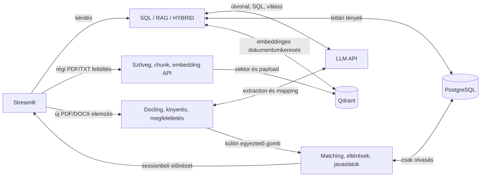

# InventoryAI – rendszerellenőrzés és szakdolgozati validálás

**Ellenőrzés:** 2026-11-07, Europe/Budapest. **Branch:** `main`; **HEAD:** `a7bd4278aaa4a7da6aa7375ff1741c6e9107ab83`. Követett módosítás nem volt; a két korábbi szakdolgozati átadás nem követett dokumentumként volt jelen. Az alkalmazás, az adat-előkészítő eszközök, a tesztek, a konfigurációk és a mentett bizonyítékok ellenőrzése történt. Új tesztfutást, matchingmérést vagy LLM-hívást nem indítottam; a helyi PostgreSQL-t csak olvasó tranzakciókban vizsgáltam. Egyedül ez a dokumentum készült el.

**Döntés:** a megadott feladat három alapfunkciója megvalósult a prototípusban. A jelenlegi alkalmazáskonfigurációval történő élő bemutató viszont még nem igazolt: PostgreSQL-hitelesítési hiba mutatható ki, és nincs ellenőrizhető, teljes, valódi LLM-es mérési bizonyíték.

## 1. A rendszer működése közérthetően

**A régi kérdés–válasz funkció.** A Streamlit a természetes nyelvű kérdést a [handle_question](../app/orchestration/orchestrator.py#L76) függvénynek adja. Előzetes mintaszűrés után LLM választ SQL-, RAG- vagy HYBRID-ágat. SQL esetén újabb LLM-hívás SQL-t készít; SQL-minták ellenőrzése, sorkorlát és PostgreSQL-lekérdezés után az LLM szöveges választ fogalmaz. RAG esetén a kérdés embeddingje Qdrant-dokumentumrészleteket keres, amelyekből az LLM válaszol. HYBRID esetén SQL-lekérdezés is történik, és az SQL-eredményből kiolvasott nevekkel szűrt dokumentumkeresés indul; találat nélkül szemantikus keresésre vált. A felület választ, útvonalat, az eredménysorok számát, forrásrészleteket, debug módban SQL-t és nyers eredményt mutat. Forrás: [_run_sql_pipeline](../app/orchestration/orchestrator.py#L31), [answer_hybrid_details](../app/rag/retrieval/rag_service.py#L105), [simple_server.py](../app/web/simple_server.py#L80).

**A régi tudástárfeltöltés külön művelet.** Az oldalsáv „Add to knowledge base” gombja PDF/TXT-fájlokat dolgoz fel: PDF-nél `pypdf`, majd szövegdarabolás, embedding és Qdrant-upsert következik. A `devices.txt` külön, előre elkészített eszközleírás-forrás az `ingest_devices` számára. Ezt nem használja az új rekordegyeztetés. Forrás: [ingest_uploaded_document](../app/rag/ingestion/ingestion_service.py#L70), [ingest_devices](../app/rag/ingestion/ingestion_service.py#L47), [extract_text_from_pdf](../app/rag/ingestion/document_parser.py#L27).

**Az új dokumentumelemzés menete:**

1. A külön PDF/DOCX-feltöltőben az **Analyze document** gomb indítja a [process_document](../app/document_processing/processing_service.py#L17) függvényt. A Docling szöveget/Markdownot, PDF-oldalankénti tartalmat és strukturált dokumentumobjektumot ad. DOCX-hez az adapter nem állít elő oldalszámokat: [parse_document](../app/document_processing/docling_parser.py#L14).
2. Az **első LLM-feladat** szövegrészletenként címke–érték–bizonyíték mezőket nyer ki. A JSON-t szigorú Pydantic-modellek ellenőrzik; hibás JSON/modellvalidáció esetén egy javító LLM-kérés lehetséges. A **második LLM-feladat** a kinyert mezőket a fájlban tárolt SQL-sémához rendeli; itt már címkék, értékek és célmezők szerepelnek, nem a teljes dokumentum. Forrás: [extract_fields](../app/document_processing/extraction_service.py#L38), [request_json](../app/document_processing/llm_json.py#L18), [map_fields](../app/document_processing/field_mapper.py#L23).
3. A normalizálás és típusellenőrzés determinisztikus. Az **Egyeztetés az adatbázissal** külön gomb: validált adatokból PostgreSQL-jelölteket keres, majd exact/fuzzy rangsorolást, mező-összehasonlítást és szabályalapú javaslatképzést végez. Itt nincs LLM-hívás. Forrás: [validate_fields](../app/document_processing/validation_service.py#L64), [reconcile_document](../app/record_matching/reconciliation_service.py#L25), [render_reconciliation](../app/web/reconciliation_preview.py#L212).
4. A felület megmutatja a megfeleltetett/megfeleltetetlen mezőket, hibákat, jelölteket, pontszámok indoklását, dokumentum- és adatbázisértékeket, bizonyítékrészleteket, rendelkezésre álló oldalszámokat és javaslatokat. A pontszám nem kalibrált valószínűség. Forrás: [render_document_analysis](../app/web/document_preview.py#L17), [_render_result](../app/web/reconciliation_preview.py#L171).

A tényleges szöveggeneráló API-hívás közös helye [ask_llm](../app/services/llm_service.py#L80); a kódbeli alapmodell `gpt-6-luna`. A külön embeddinghívás [embed_text](../app/rag/embedding/embedding_service.py#L35), alapmodellje `text-embedding-3-large`. A vizsgált `.env` ezeket nem írja felül; a modellnév és a kulcs konfigurálása önmagában nem bizonyít sikeres szolgáltatói hozzáférést.

**Hibás és bizonytalan adatok:** a [prepare_document](../app/record_matching/preparation.py#L32) ellenőrzi a forrásbizonyítékot és a normalizálás visszavezethetőségét; az ellentmondó azonosítókat és felismert többeszközös bemeneteket blokkolja. Ez utóbbi heurisztika, nem általános többeszközös feldolgozás. A hiányzó adat nem törlési utasítás; a pénzösszegek összevetése egyező pénznemet igényel. Hiányos keresés vagy DB-hiba nem bizonyít rekordhiányt. A matching elsődlegesen leltári számot, majd másodlagos azonosítót és korlátozott névhasonlóságot használ; sorozatszám/service tag nem helyettesítheti a belső azonosítót. Forrás: [InventoryRepository._search](../app/record_matching/repository.py#L226), [MatchingEngine.match](../app/record_matching/matching_engine.py#L100), [compare_fields](../app/record_matching/comparison_service.py#L18).

## 2. PostgreSQL és Qdrant

**PostgreSQL – friss helyi ellenőrzés.** A `localhost:5432` kiszolgálón mindkét adatbázis létezik; mindkettő egyetlen `public` táblája az `inventory_items`.

| Tulajdonság | Eredeti `inventory` | `inventory_ai_clean` |
|---|---|---|
| Szerep, adatok | Korábbi leltári tesztadatok; 1000 sor, 20 különböző név, 6 helyszín | Reprodukálható szintetikus készlet; 1000 sor, 26 modellnév, 5 helyszín |
| Leltári szám | 992 különböző érték; 8 duplikált csoport, összesen 16 sor | 1000 különböző érték; nincs duplikáció |
| Adatbázis-garanciák | Minden oszlop nullable; nincs constraint vagy index | Mind a 11 oszlop NOT NULL; `UNIQUE(inventory_number)` és 9 üzleti CHECK |
| Cikkszám | Jelenleg 1000 különböző érték, egyediségi garancia nélkül | 26 ismétlődő érték; nem eszközazonosító |

A közös 11 mező: szövegként `item_code`, `name`, `currency`, `inventory_number`, `location`; egész számként `sub_code`, `purchase_value`, `depreciation`, `current_value`, `quantity`; dátumként `activation_date`. Külön dokumentumtábla, mesterséges rekord-ID, sorozatszám-, gyártó- vagy modell-oszlop nincs. A clean CHECK-ek formátumot, nem üres szövegeket, nemnegatív pénzértékeket, pénznemkódot és `quantity=1` feltételt írnak elő. Forrás: [schema.json](../config/schema.json), [clean táblalétrehozás](../migrations/clean/001_create_inventory_items.sql), [constraint-migráció](../migrations/clean/002_add_inventory_constraints.sql).

**Aktív konfiguráció:** a `.env` `inventory` adatbázist és `postgres` felhasználót állít be. A vele végzett kapcsolódást a szerver **hitelesítési hibával elutasította**. A `.env.clean.local` működő helyi hitelesítésével, explicit adatbázisválasztással mindkét táblát read-only módban sikerült ellenőrizni; ez nem változtatta meg az alkalmazás beállítását. A clean teljes adattartalmára a [verify_dataset](../app/test_data/database.py#L251) séma-, constraint-, minőségi és kanonikus hash-ellenőrzése is sikeres volt. A mintafájl reader szerepkört ajánl, de a tényleges clean helyi konfiguráció is `postgres` superusert használ. A már futó Streamlit-folyamat örökölt környezete nem ismert: [get_connection](../app/db/connection.py#L12) környezeti változókból dolgozik, a `.env.clean.local` fájlt nem választja ki automatikusan.

Az adatbázis-megfigyelések alapja read-only tranzakcióban `pg_database`, `information_schema.columns`, `pg_constraint`, `pg_indexes` és összesített `COUNT`/`GROUP BY` lekérdezés volt. Az `inventory` kapcsolódási hibája és a clean adatkészlet épsége **mai ellenőrzés**, nem a régi riportokból átvett állítás.

**Ki olvas és ki ír?** A régi SQL/HYBRID-ág és az új egyeztetés olvas. Az új [InventoryRepository._transaction](../app/record_matching/repository.py#L107) read-only, repeatable-read tranzakciót kényszerít ki. A régi [execute_query](../app/db/executor.py#L19) SQL-szűrésre és limitekre támaszkodik, maga nem állít read-only tranzakciót; ezért nem indokolt az egész alkalmazást adatbázisszinten írásvédettnek nevezni. A külön adminisztrációs eszközök tudnak adatbázist létrehozni, migrálni és tesztadatot betölteni, explicit végrehajtási kapcsolókkal: [create_database](../app/test_data/database.py#L112), [migrate](../app/test_data/database.py#L187), [load_dataset](../app/test_data/database.py#L219). A `postgres` adatbázis itt karbantartási cél; a tesztek saját ideiglenes klasztert használnak.

**Qdrant és a kapcsolat.** A régi RAG-ág `devices` alapértelmezett kollekciójába 3072 dimenziós vektort és `name`, `section`, `text`, `source`, `doc_type` payloadot ír. A pont UUID-je chunkazonosító, nem PostgreSQL-kulcs. Nincs közös üzleti rekord-/dokumentumazonosító vagy kapcsolótábla. A HYBRID névszűrése futásidejű összekötés; általános feltöltésnél a `name` ráadásul a fájlnév, ezért az eszköznévvel való egyezés nem garantált. A régi névszűrt keresés szükség esetén payload-indexet is létrehoz; az új egyeztető nem használ Qdrantot. Forrás: [upsert_chunks](../app/rag/ingestion/ingestion_service.py#L17), [chunk_document_text](../app/rag/ingestion/chunker.py#L67), [retrieve_by_name](../app/rag/retrieval/retriever.py#L30), [init_collection/search](../app/rag/vector_store/qdrant_client.py#L43). Élő Qdrant-tartalomellenőrzés nem történt; ezek a kód által kezelt adatok, nem a távoli kollekció aktuális leltára.

**Megmaradás:** a régi, sikeres RAG-indexelés vektorai és szöveges payloadjai a Qdrantban maradnak; a kód nem ad hozzájuk TTL-t vagy automatikus takarítást. A tároló tényleges megőrzési idejét az infrastruktúra határozza meg. Az új ág fájltartalma, mezői és javaslatai memóriában/Streamlit-sessionben élnek; új feltöltés vagy új elemzés törli az előző eredményt, és munkamenetvesztés vagy szerverújraindítás után nincs helyreállítás; rögzített megőrzési idő sincs. Nincs alkalmazásoldali tartós feltöltésmentés, PG-módosítás vagy Qdrant-indexelés. Forrás: [_clear_preview](../app/web/document_preview.py#L12), [clear_reconciliation](../app/web/reconciliation_preview.py#L48). A Docling modellcache és a fájlnév/státusz naplózása nem dokumentumarchívum; szolgáltatói naplózás/megőrzés a repositoryból nem igazolható.

## 3. A hivatalos feladatkiírás teljesülése

A státuszok a **megadott kivonat prototípusfunkcióira** vonatkoznak. A működő kódot és az alábbi tesztutakat igazolják, nem mai, élő LLM-es sikerarányt.

| Követelmény | Státusz és konkrét bizonyíték | Védéskor kimondandó korlát |
|---|---|---|
| PDF/DOCX → strukturált leltári mezők | **MEGVALÓSULT.** `process_document`, `extract_fields`, `map_fields`; [test_real_docx_smoke](../tests/test_document_processing.py#L204), [test_real_documents_through_processing_with_stubbed_llm_then_postgres](../tests/test_inventory_clean_integration.py#L288). | Valódi Docling, helyettesített LLM; élő extraction/mapping pontosság nem mért. Több eszköz automatikus szétválasztása nincs. |
| Összevetés PostgreSQL-rekordokkal | **MEGVALÓSULT.** `InventoryRepository.search`, `MatchingEngine.match`, `compare_fields`; [test_live_unique_identifier_can_finish_without_global_scan](../tests/test_matching_postgres.py#L111), [test_T03_location_difference_does_not_change_identity_and_preserves_evidence](../tests/test_inventory_identity.py#L39). | Valódi PG-tesztek vannak. A jelenlegi `.env` hitelesítése hibás; a régi adatbázis nem garantál egyedi leltári számot. |
| Ellenőrizhető, indokolt kezelési javaslat | **MEGVALÓSULT.** [suggest_actions](../app/record_matching/suggestion_engine.py#L9), UI `_render_actions`; [test_ranking_evidence_differences_and_advisory_actions_render](../tests/test_reconciliation_ui.py#L95). | Csatolás-, frissítés-, újrekord- és kéziellenőrzés-javaslat van. Minden akció `executable=False`; végrehajtó/jóváhagyási munkafolyamat nincs: [SuggestedAction](../app/record_matching/models.py#L162). |

A kivonat **javaslatot** kér, ezért PG-írás, tényleges csatolás és automatikus Qdrant-indexelés nem következik belőle. Ezek opcionális továbbfejlesztések. Ha a teljes, itt nem közölt hivatalos kiírás tartós dokumentumkezelést vagy végrehajtást is megkövetel, azt külön kell vizsgálni. A szakirodalmi áttekintés és a dolgozatszöveg minősége pusztán a repository alapján nem minősíthető.

## 4. Tesztelési helyzet

- **74 esetes készlet:** 10 kalibrációs és 64 teszteset az exact-only és hybrid matching összehasonlítására, ismert strukturált bemenettel, élő LLM/PG nélkül. A mentett tesztmetrikák: precision mindkettőnél **1,0000**; recall **0,5319 → 0,6596**; F1 **0,6944 → 0,7949**. Forrás: [run_evaluation](../app/evaluation/runner.py#L156), [matching_metrics.json](../evaluation/results/matching_metrics.json). Ez nem teljes dokumentumfeldolgozási pontosság.
- **Clean készlet:** 1000 reprodukálható rekord, 16 referenciával ellátott helyzet, helyzetenként PDF és DOCX, összesen 32 dokumentum. Fájl- és ground-truth-integritásuk most is ellenőrizve. Az offline és izolált PG-riportban **14/16** megfelelés szerepel. D05/D06 esetén a várt `AMBIGUOUS_MATCH`/`CONFLICTING_DATA` helyett `SEARCH_INCOMPLETE` a státusz; a többi ellenőrzési dimenzió egyezik. A bemenet itt előre megadott mezőlista: [processing_input](../app/test_data/evaluation.py#L17), [offline riport](../evaluation/clean_inventory/matching_offline.json), [PG-riport](../evaluation/clean_inventory/matching_postgres.json).
- **Valódi integráció:** [isolated_postgres](../tests/test_matching_postgres.py#L18) saját PG-klasztert indít; constraint-, tranzakció-, keresés- és UI-tesztek kapcsolódnak hozzá. A [mentett ellenőrzés](../evaluation/clean_inventory/postgres_verification.json) 32 valódi Docling-olvasási próbát, valamint D01/D02 mindkét formátumán teljes processing→PG tesztutat rögzít, **helyettesített extraction/mapping LLM-válaszokkal**. A régi SQL/RAG/HYBRID smoke teszt is helyettesíti a külső AI-funkciókat; a Qdrant-kliens a tesztekben memóriabeli: [conftest.py](../tests/conftest.py#L1). Igazolt teljes, élő LLM-es eredmény nem található a vizsgált bizonyítékokban.
- **Eredmények érvényessége:** most is **63/63**, illetve **84/84** munkakönyvtári forráshash egyezik a matching/clean manifestekkel. Az [inventory_search_benchmark.json](../evaluation/results/inventory_search_benchmark.json) implementációhash-e és külön tesztforráshash-e is illeszkedik; a futásidők történeti, körülhatárolt részfolyamatok mérései. A [JUnit](../evaluation/clean_inventory/test_results.xml) 2026-10-18-án **311 sikeres, 0 hibás, 0 kihagyott** tesztet rögzít, de nincs közvetlen commit-/tesztmanifest-kötése. A jelenlegi teljes suite újrafuttatását ez nem bizonyítja. Részletek: [forráskonzisztencia-audit](thesis_source_consistency_audit.md).

## 5. Végső szakmai értékelés

**1. Teljesíti-e a lényegi funkcionális követelményeket?** Igen, a megadott kivonat szerinti, korlátozott dokumentumelemző és döntéstámogató prototípusként. A kinyerés, adatbázis-egyeztetés és indokolt javaslat létezik, integrációjuk tesztelt. Élő, végpontok közötti LLM-minőség és a jelenlegi alkalmazás működőképessége azonban még nem igazolt; ezeket nem helyettesíti a 311-es tesztszám.

**2. Kell-e PG-írás vagy automatikus Qdrant-indexelés?** A közölt kiírás teljesítéséhez **nem**. Tartós csatolás, emberi jóváhagyás utáni végrehajtás és közös PG–Qdrant azonosító külön továbbfejlesztés lenne.

**3. Mi kerül tartós tárolásra új dokumentum elemzésekor?** Az új PDF/DOCX-ágban **sem a feltöltött dokumentum, sem a kinyert mezők, sem a javaslatok nem kapnak alkalmazásoldali tartós üzleti tárolást**. A felület sessionállapotot őriz. A külön régi tudástárfeltöltés ezzel szemben Qdrantban tárol vektorokat és szövegrészleteket.

**4. A legfontosabb három teendő:**

1. **Működő bemutatókonfiguráció:** tudatosan kiválasztani az adatbázist, rendezni az alkalmazás hitelesítését, majd igazolni a ténylegesen induló folyamat célját. A clean készlet kész; a demonstrációhoz olvasási jogosultságú szerepkör ajánlott.
2. **Kis, dokumentált élő LLM-es végpontok közötti próba:** reprezentatív PDF/DOCX dokumentumokon, független referenciaadatokkal külön mérni a mezőkinyerést, megfeleltetést és végső javaslatot; rögzíteni modellazonosítót, hibákat, költséget és forrásverziót. Ez bizonyítékpótlás, nem új mentési funkció.
3. **A dolgozat állításainak pontosítása:** külön kezelni matchingmetrikát és extraction-pontosságot; bemutatni D05/D06 eltérését, a többeszközös korlátot és a javaslatok végrehajthatatlanságát. A 311 tesztet dátumozott történeti eredményként idézni; mai commitra vonatkozó teljes tesztállításhoz verzióhoz kötött új bizonyíték szükséges.
