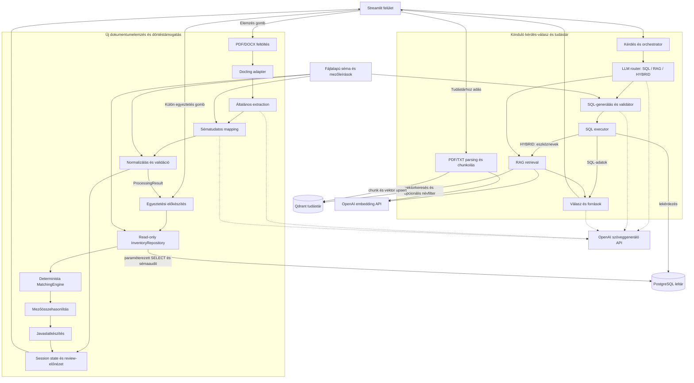
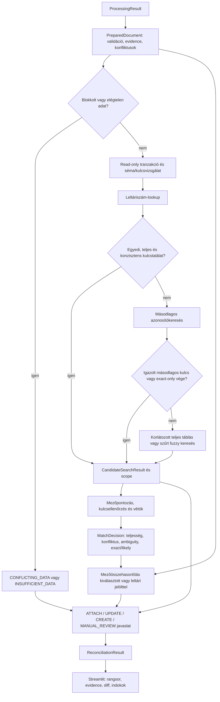

# InventoryAI – szakdolgozati technikai átadás

**Vizsgálat dátuma:** 2026-10-25. **Repository:** `inventory-ai`. **Vizsgált commit:** `a7bd427` (a vizsgálat kezdetén tiszta munkakönyvtár).

Ez a dokumentum ellenőrzött műszaki forrásanyag a szakdolgozat 3–5. fejezetéhez. Nem kész szakdolgozati fejezetszöveg. A hivatkozott sorszámok a fenti verzióhoz tartoznak. A relatív útvonalak a repository gyökeréből értendők. Az elemzés során kizárólag ez a dokumentum készült; alkalmazáskód, konfiguráció, tesztadat és korábbi mérési riport nem változott.

### Bizonyítékok értelmezése

| Jelölés | Jelentés ebben az átadásban |
|---|---|
| **IMPLEMENTED** | A jelenlegi forráskód igazolja a működést. Önmagában nem mérési eredmény. |
| **TESTED – mentett** | Konkrét teszt és mentett eredmény igazolja, a futás időpontjával és hatókörével együtt. |
| **TESTED – friss** | Az átadás készítésekor ismét ellenőrzött tulajdonság. |
| **DOCUMENTED** | Más dokumentum állítása; önálló kód- vagy mérési bizonyíték nélkül nem tekintendő igazolt működésnek. |
| **PLANNED** | Továbbfejlesztési irány, amelyet a jelenlegi implementáció nem valósít meg. |
| **UNKNOWN** | A rendelkezésre álló bizonyítékból nem dönthető el. |

Elsődleges forrás a Python-kód, a modellek, a promptok, a séma és a migrációk, majd a tesztek és a gépi riportok. A fejlesztői leírásokat ezekkel összevetve használtam. A **TESTED** jelölés mindig az adott teszt hatókörére vonatkozik, nem általános üzemi garancia.

## I. Vezetői technikai összefoglaló

A kiinduló InventoryAI természetes nyelvű kérdésekre válaszoló alkalmazás: LLM választ SQL, RAG és HYBRID útvonal között. A SQL-ág PostgreSQL-adatokra, a RAG Qdrantban tárolt dokumentumrészletekre támaszkodik. A HYBRID az SQL-eredmények eszközneveihez keres dokumentációt. Ezt az `app/orchestration/orchestrator.py::handle_question` (76. sortól) szervezi össze.

Az új fejlesztés **külön, felhasználói gombnyomással indított dokumentumelemzési és rekordegyeztetési ág**. PDF/DOCX → Docling → általános LLM-mezőkinyerés → külön LLM-megfeleltetés az SQL-sémára → determinisztikus normalizálás és validáció → külön PostgreSQL-egyeztetés → mezőeltérések → indokolt műveleti javaslatok. A két nyilvános belépési pont:

- `app/document_processing/processing_service.py::process_document` (17–41): `ProcessingResult` előállítása, adatbázis-keresés nélkül.
- `app/record_matching/reconciliation_service.py::reconcile_document` (25–98): `ProcessingResult` → `ReconciliationResult`, új LLM-hívás nélkül.

**IMPLEMENTED:** PDF/DOCX-parsing, explicit típusos köztes modellek, általános extraction, sématudatos mapping, értéknormalizálás, eredetmegőrzés, leltári számot előnyben részesítő keresés, egyediségvizsgálat, fuzzy rangsorolás, konfliktus- és bizonytalanságjelzés, mezőösszehasonlítás, négy javaslattípus, Streamlit-előnézet, offline kiértékelés és elkülönített szintetikus tesztadatbázis-eszközök.

**A megvalósítás határa:** a javaslatok nem végrehajthatók (`SuggestedAction.executable: Literal[False]`). Nincs tartós dokumentum–rekord kapcsolat, jóváhagyási napló, jóváhagyásgomb vagy módosításvégrehajtó. A Qdrant és a PostgreSQL között nem jött létre perzisztált üzleti kulcskapcsolat. A több eszközt tartalmazó dokumentumoknál a rendszer konzervatívan megállhat; általános entitáscsoportosítás nincs.

**Bizonyítékok röviden:** a 2026-10-18-i JUnit 311 sikeres tesztet rögzít, és a clean riportok 84 forrásfájlt összefogó hash-e egyezik a jelenlegi állapottal. Most újrafuttatott 16 offline üzleti esetből 14 felel meg minden referenciafeltételnek. D05 és D06 esetén a státusz továbbra is `SEARCH_INCOMPLETE`; az azonosság, az eltérések, a javaslatok és a review-elvárás megfelelnek a referenciának. Élő LLM-es mezőkinyerési pontosságot ezek a mérések nem igazolnak.

## II. A rendszer teljes architektúrája

### II.1. A három elkülönülő működési út

| Útvonal | Bemenet és lépések | Kimenet és tárolás |
|---|---|---|
| Kérdés–válasz | Streamlit-kérdés → injection-heurisztika → LLM-router → SQL/RAG/HYBRID → LLM-válasz | Válasz, SQL-eredmény, dokumentumforrások; a chat SQL executorának külön biztonsági korlátai vannak. |
| RAG tudástár feltöltése | PDF/TXT → `extract_text_from_upload` → szövegdarabolás → embedding → Qdrant upsert | Tartós dokumentumrészletek és vektorok Qdrantban. |
| Strukturált dokumentumelemzés | PDF/DOCX → `process_document` → felületi előnézet → külön gomb → `reconcile_document` | Strukturált mezők, jelöltek, eltérések és javaslatok a Streamlit-munkamenetben. Üzleti adatbázis-írás nincs. |

A strukturált ág nem az `app/rag/ingestion/ingestion_service.py` bővítéséből áll. A Docling-adapter és az extraction külön `app/document_processing` csomagban található. A rekordegyeztetés külön `app/record_matching` csomag. A UI közös, a két feltöltés célja és mellékhatása különböző. [Kód: `app/web/simple_server.py`, 25–64; `app/web/document_preview.py::render_document_analysis`, 17–61.]

### II.2. Kiinduló rendszer → új komponens → integrációs pont → indoklás

Az indoklás oszlop az implementációból következő műszaki előnyt jelöli; nem állítja, hogy minden döntéshez eredeti tervezési jegyzőkönyv készült.

| Kiinduló elem | Új komponens | Integrációs pont | Műszaki indoklás |
|---|---|---|---|
| Közös LLM-wrapper | Extraction, mapping, JSON-javítás | `llm_service.ask_llm` | Egy helyen kezelhető a kliens és a szolgáltatói hibák osztályozása. |
| Fájlalapú SQL-séma és leírások | `field_mapper`, validáció | `schema_service.load_schema/load_descriptions` | A mapping tényleges, engedélyezett oszlopneveket kap; a típuskezelés ugyanahhoz a sémához kötött. |
| PostgreSQL-kapcsolat | `InventoryRepository` | `get_connection(connect_timeout=...)` | A kapcsolatkonfiguráció újrahasznosítható; a keresés saját read-only tranzakciót és paraméterezett SQL-t használ. |
| Streamlit főoldal | `document_preview`, `reconciliation_preview` | Új expander a meglévő alkalmazásban | A kérdés–válasz ág mellett külön indítható elemzési folyamat jelenik meg. |
| PDF/TXT RAG parser | Docling PDF/DOCX-adapter | Nincs közvetlen hívás a két parser között | A Docling strukturált dokumentumreprezentációja használható mezőkinyeréshez. |
| Qdrant tudástár | Nincs új Qdrant-komponens a matchingben | Csak a közös alkalmazáskeret | A rekordazonosítás PostgreSQL-bizonyítékokra támaszkodik. |
| Eredeti leltári tábla | Clean adatgenerátor és admineszközök | Külön CLI és külön `inventory_ai_clean` cél | Reprodukálható, megszorításokkal védett mérési környezet az eredeti adatok átírása nélkül. |

**Git-bizonyíték:** a `5b85b74..a7bd427` összehasonlításban új a dokumentumfeldolgozó, rekordegyeztető, kiértékelő és tesztadat-csomag. A meglévő `app/db/connection.py`, `app/services/llm_service.py`, `app/services/schema_service.py`, `app/web/simple_server.py`, valamint a sémaleírás és a függőségek módosultak. A RAG-csomag és az orchestrator fájljai ebben az összehasonlításban nem módosultak. Ettől még futásidejű viselkedésük változhat a közös wrapper/modellel vagy a konfigurált adatbázissal; az „érintetlen” itt fájltartalomra vonatkozik.

### II.3. Qdrant, PostgreSQL és az AI helye

Az `ingestion_service.py::upsert_chunks` (17–44) Qdrant-payloadja pontosan `name`, `section`, `text`, `source`, `doc_type` mezőket ad át. A pontazonosító `uuid5` az input szöveges jellemzőiből; nem PostgreSQL-kulcs. Nincs payloadbeli `inventory_number`, `item_code`, SQL-rekordazonosító, és ez az íróút oldalszámot sem tárol. A kapcsolattábla és a dokumentumcsatolási migráció is hiányzik.

HYBRID módban az orchestrator `_extract_names_from_sql_result` (44–73) névlistát képez. A `retriever.py::retrieve_by_name` (30. sortól) a kisbetűs névre Qdrant-filtert és kérdés-embeddinget használ; az `answer_hybrid_details` a szükséges esetben általános szemantikus keresésre tér vissza. Ez futásidejű dokumentációkeresés, nem a mostani rekordegyeztető algoritmus.

| Hely | AI/LLM szerepe | Mit nem bizonyít? |
|---|---|---|
| PDF Docling | Helyi layout-, táblázat- és szükség esetén OCR-modellek | Nem állít elő önmagában leltári SQL-rekordot. |
| DOCX Docling | Word-struktúra feldolgozása a backenddel | Nem a PDF képalapú modellfolyamát futtatja. |
| Új extraction | LLM: explicit címke–érték tények és opcionális dokumentumtípus | A JSON-séma helyessége nem bizonyítja a tények helyességét. |
| Új mapping | Külön LLM: a kinyert mezők jelentésének hozzárendelése a célsémához | Nem dönt rekordazonosságról. |
| Matching, diff, javaslat | Python-szabályok, RapidFuzz, SQL-lekérdezések | Nincs LLM-hívás e szakaszokban. |
| Régi chat | LLM-router, Text-to-SQL, válaszmegfogalmazás | Külön hívások és külön biztonsági felület. |
| RAG | OpenAI embedding, vektorkeresés, LLM-válasz | A vektorhasonlóság nem üzleti rekordazonosság. |

A szöveggenerálás alapértelmezett modellje `gpt-6-luna`. Az embedding külön konfigurációja `text-embedding-3-large` (`embedding_service.py`, 10. sor). A modellnév jelenléte a kódban nem igazol szolgáltatói elérhetőséget vagy projektjogosultságot. A wrapper egyik modellhez sem rendel bizonyított minőségi garanciát.

## III. A 3. fejezethez szükséges tervezési információk

### 3.1. Cél és kapcsolódás

- **IMPLEMENTED cél:** feltöltött dokumentum explicit adatait átvezetni az aktuális leltári séma fogalmaira, majd ellenőrizhetően összevetni a leltárral. A kimenet mezőnként visszakereshető adat és indokolt javaslat.
- **Történeti határ:** a korábbi SQL/RAG/HYBRID rendszer dokumentációt keresett és kérdésekre válaszolt. A strukturált extraction, általános matching és diff az új modulok feladata. A dolgozat 2.9-ben leírt hiányosságokat ezért a kiinduló rendszerhez kell kötni.
- **Integrációs döntés:** a chatbotot nem szükséges lecserélni, mert az új szolgáltatások külön bemenettel és kimeneti modellekkel rendelkeznek. A főoldal meghívja az új előnézetet; a chat ugyanúgy az orchestratoron keresztül működik.
- **Hatókör:** egyetlen biztonságosan értelmezhető eszköz mezőinek feldolgozása. Több leltársor és összeférhetetlen ismételt érték esetén jelzés és kézi ellenőrzés történik, nem automatikus rekordokra bontás.

Forrás: `processing_service.py::process_document`; `reconciliation_service.py::reconcile_document`; `preparation.py::prepare_document`; `simple_server.py`, 63–64. A szakdolgozat korábbi 3.1 szövegét nem tekintettem megvalósítási bizonyítéknak.

### 3.2. Követelmények

| Követelmény | Tényleges megoldás | Állapot és korlát |
|---|---|---|
| PDF/DOCX támogatás | Docling `DocumentStream` és két engedélyezett formátum | **IMPLEMENTED; TESTED – mentett**, valódi dokumentumokkal. |
| Ismeretlen címkék kezelése | Általános extraction, külön mapped/unmapped listák | **IMPLEMENTED**; nincs dokumentumtípusonként zárt mezőséma. |
| Strukturált köztes eredmények | Szigorú Pydantic-modellek | **IMPLEMENTED; TESTED – mentett**; szemantikai igazságot önmagukban nem ellenőriznek. |
| Bizonyíték megőrzése | Nyers adat, evidence, parseroldal | **IMPLEMENTED**; DOCX-oldalszám nincs, ismételt azonos tény első oldala marad meg. |
| Biztos azonosság | Tényleges DB-kulcs introspekciója és konfliktusvizsgálat | **IMPLEMENTED; TESTED – mentett**; puszta szövegegyezés nem elegendő. |
| Elírások kezelése | RapidFuzz névhasonlóság és modellszám-vétó | **IMPLEMENTED**; gyártó/modell külön oszlop nincs. |
| Bizonytalanság jelzése | Nyolc matchingstátusz, keresési metaadatok, review | **IMPLEMENTED; TESTED – friss** a D05/D06 példákon is. |
| Mezőszintű változás | Öt összehasonlítási státusz | **IMPLEMENTED**; hiány és NULL nem automatikus törlési/frissítési szándék. |
| Döntéstámogatás | Négy javaslattípus és indoklás | **IMPLEMENTED**; végrehajtás/jóváhagyás nincs. |
| Korlátozott erőforrásigény | Fájl-, oldal-, chunk-, batch-, kandidáns- és lekérdezési korlátok | **IMPLEMENTED**; nincs teljes dokumentumra vonatkozó token-, költség- vagy összfutásidő-garancia. |
| Reprodukálhatóság | Seed, kanonikus fájlok, hash-ek, független referencia | **IMPLEMENTED; TESTED – friss** a bundle visszaellenőrzésével. |
| Adatbiztonság | Advisory ág, read-only matching, külön seedeszközök | **IMPLEMENTED**; nem a teljes régi SQL-ágra vonatkozó read-only tranzakciós garancia. |
| Éles szolgáltatási minőség | Nincs élő extractionbenchmark, SLA vagy terhelési garancia | **UNKNOWN**; 311 tesztből nem következik production-ready minősítés. |

### 3.3. Architektúra és tervezési döntések

A határok célja az egyes hibák elkülönítése: parsinghiba, hibás LLM-JSON, téves mapping, érvénytelen érték, hiányos SQL-keresés és üzleti ellentmondás különböző problémák. A modellfolyamot a IV–V., a döntési sorrendet a VI. rész rögzíti.

| Döntés | Megfigyelhető megoldás / indoklás | Az indoklás bizonyítékszintje |
|---|---|---|
| Docling | Egységes PDF/DOCX dokumentumobjektum, Markdown és oldalinformáció; a meglévő kód ezt használja. | A technológiaválasztás a feladatban megadott és a `docs/document_processing_v1.md` által dokumentált. Unstructured/Mistral elleni helyi összehasonlító mérés nem található; a választás teljes eredeti indoklása **UNKNOWN**. |
| LLM-extraction | Változó üzleti címkékből általános mezőlista készül; a séma még nem korlátozza a kinyerést. | Implementációból következő műszaki indoklás; prompt és `extract_fields`. |
| Külön mapping | A forráscímke és nyers érték megmarad, ismeretlen mező unmapped lehet, a célmező allowlist ellenőrizhető. | Dokumentált felépítés és implementációból következő előny; `document_processing_v1.md`, `map_fields`. |
| Pydantic | Tiltott extra attribútumok, szigorú típusok, ismert kimeneti szerkezet. | Implementációból következő műszaki indoklás; modellek és JSON-javítás. |
| Determinisztikus matching | Azonos bemenet/séma/konfiguráció mellett visszakövethető szabályok, súlyok és vétók. | Dokumentált architektúra: `docs/record_reconciliation.md`, 3–34, 197–254; megvalósítás és determinisztikussági ellenőrzés a runnerben. |
| Elsődleges leltári szám | Fizikai eszköz üzleti kulcsa; a cikkszám több példányt jelölhet. | Dokumentált döntés: `docs/inventory_number_report.md`, `docs/clean_inventory_report.md`; repository első keresési szakasza igazolja. |
| DB-szintű UNIQUE | Egy megfigyelt találat még nem egyediségbizonyíték; a kulcs feltételeit a DB garantálja és a repository ellenőrzi. | Dokumentált és kóddal igazolt döntés. |
| Fuzzy névegyeztetés | Elírás/szórendeltérés mellett jelöltek nyerhetők, de a típusazonosság nem fizikai azonosság. | Kód és exact-only/hybrid mérés; más fuzzy könyvtárak összehasonlítása nincs igazolva. |
| Külön diff | Azonos eszköznek változhat a helyszíne vagy értéke. Az azonosság és az attribútumeltérés eltérő kérdés. | Dokumentált és D01/D02 tesztekkel igazolt döntés. |
| Advisory működés | Hibás kinyerés vagy bizonytalanság nem eredményez automatikus leltármódosítást. | Dokumentált: `record_reconciliation.md`; `executable=False`, író végrehajtó hiánya. |
| Szintetikus clean környezet | Független, determinisztikus referencia, érvényes kulcsok, megismételhető hibaforgatókönyvek. | Dokumentált: `clean_inventory_report.md`, 14–28; generátor és bundle-verifier igazolja. |

Ezeket nem szabad utólagos, méréssel igazolt „optimális technológiaválasztásként” bemutatni. A kód alapján levezethető előny és a ténylegesen dokumentált eredeti döntés külön állítás.

### 3.4. Adatmodell és adatbázis-tervezés

A célmodellben **egy sor egy fizikai eszköz**, `quantity=1`, a `inventory_number` üzleti kulcs. A meglévő 11 oszlop neve és SQL-típusa megmaradt. A clean migráció nem vezetett be mesterséges `id` oszlopot; a matching a tényleges kulcsmezőkből készít JSON-alakú rekordazonosítót. Ez megőrzi a meglévő séma fogyasztóinak kompatibilitását. A 11 oszlop megtartása dokumentált; az ebből eredő kompatibilitási előny műszaki következtetés, nem adatbázis-alternatívák benchmarkja.

Az `item_code` terméktípust jelölhet és ismétlődik; `sub_code=0` a clean készletben. Sem a cikkszám, sem a cikkszám–alszám páros nincs ott egyedivé téve. A matching általánosan tud tényleges, más adatbázisban meglévő összetett kulcsról, de ezt nem szabad a clean séma tulajdonságának nevezni.

Három bizonyítékkört kell külön tartani:

1. **Régi `inventory` történeti audit:** 2026-10-17, 1000 sor, 8 duplikált leltáriszám-csoport, 16 érintett sor, nincs elfogadott PK/UNIQUE; NULL/üres/whitespace számlálók 0. A mintákban távoli jövőbeli dátumok és általános eszköznevek is szerepelnek. Forrás: `evaluation/results/inventory_number_audit.json`. Ez nem friss adatbázisállapot.
2. **Izolált clean tesztkörnyezet:** tényleges PostgreSQL-klaszter, 1000 szintetikus rekord, 11 NOT NULL oszlop, UNIQUE leltári szám és 9 CHECK. Forrás: clean migrációk, `postgres_verification.json`, integrációs teszt. A sentinelként létrehozott `inventory` ebben a tesztklaszterben volt, nem a felhasználó üzleti adatbázisa.
3. **Helyi telepítésről mentett eredmények:** `evaluation/clean_inventory/local_load.json` sikeres 1000 soros betöltést, a `local_verification.json` megfelelő sémát, megszorításokat és adathash-t rögzít. Ezekből a telepítéskori állapot igazolható, de nincs bennük időbélyeg vagy forrásmanifest. Az átadáskor az élő DB-t nem kérdeztem le. A jelenlegi `.env` fájl célja nem `inventory_ai_clean`, a benne megadott felhasználó `postgres`; egy már futó folyamat környezete eltérhet ettől.

A régi `migrations/001_inventory_number_unique.sql` audit után alkalmazható, adatokat automatikusan nem tisztító migráció. Nem azonos a külön clean adatbázis felépítésével. Az alkalmazás normál futása egyik migrációt sem futtatja.

### 3.5. Rekordegyeztetési stratégia

Az előkészített, validált értékek alapján először célzott leltáriszám-keresés történik. Egy ténylegesen egyedi, a megadott további azonosítókkal konzisztens találat lezárhatja a keresést. Egyébként másodlagos cikkszám/ellenőrzött összetett kulcs, majd hybrid módban korlátozott fuzzy keresés következik. A keresés teljességét külön metaadatok írják le; az exact találat hatóköre és a globális hiány bizonyítása különböző.

Név, helyszín és aktiválási dátum növelheti a hasonlóságot, de nem helyettesíti a valódi egyedi azonosítót. Azonosítóellentmondás és eltérő modellszám megakadályozza a jelölt elfogadását. A keresési és pontozási sorrend részleteit a VI. fejezet adja; forrás: `repository.py::_search`, `MatchingEngine.score/match`.

### 3.6. Eltérésfelismerés és döntéstámogatás

Az `EXACT_MATCH` azt mondja ki, hogy a dokumentum melyik eszközhöz tartozhat igazoltan. Nem azt, hogy minden mező változatlan. A `compare_fields` külön állít elő EQUAL/DIFFERENT/UNKNOWN/INVALID/NOT_COMPARABLE állapotot. A javaslatok erre, az eredetellenőrzésre és a keresési bizonyítékra épülnek.

A rendszer emberi ellenőrzést igénylő eseteket **megjelenít**, de nincs implementált tartós jóváhagyási folyamat. Az `ATTACH_DOCUMENT` és `UPDATE_CANDIDATE` neve egy javaslat tartalmát írja le. Egyik sem küld SQL-írást vagy tárol dokumentumkapcsolatot. Forrás: `suggestion_engine.py::suggest_actions`, `models.py::SuggestedAction`, `reconciliation_preview.py::_render_actions`.

### 3.7. Biztonság és integráció

| Réteg | Megvalósított védelem | Határ / hiányosság |
|---|---|---|
| Dokumentumbemenet | Név leválasztása az útvonalról, PDF/DOCX kiterjesztés-allowlist, üres fájl és méretkorlát, Docling státuszellenőrzés | Nincs saját antivírus, teljes sandbox vagy általános veszélyesdokumentum-vizsgálat. |
| LLM | Nem megbízható adatként jelölt tartalom, kötött JSON-modellek, egy javítás, célmező-allowlist | Az instrukció promptban szerepel; a wrapper egyetlen user-üzenetet küld. A strukturált JSON is tartalmazhat hibás tényt vagy mappinget. |
| Bizonyíték | Evidence-részlet forrásbeli jelenléte, oldal és nyers érték ellenőrzése | A szövegben szereplés nem igazolja az üzleti állítás hitelességét vagy a dokumentum eredetét. |
| Új matching SQL | `sql.Identifier`, kötött értékparaméterek, allowlist, LIKE-escape | Nincs Text-to-SQL ezen az ágon. A paraméterezés nem igazolja a keresés szemantikai teljességét. |
| Új matching tranzakció | `readonly=True`, `REPEATABLE READ`, statement/lock timeout, friss kapcsolat | A tranzakció snapshotja időhöz kötött; nincs későbbi jóváhagyáskor végzett verzióellenőrzés, mert executor sincs. |
| Rekordkulcs | Valódi teljes UNIQUE/PK introspekció, NULL és üres kulcs kizárása | A UNIQUE a tárolt értékekre vonatkozik, nem tetszőleges normalizált változatra. |
| Erőforrás | Kandidánskorlát, teljes táblás vizsgálat korlátja, mezőhosszkorlát | Hiányos keresésnél nincs globális hiányállítás és rendszerint nincs új rekordjavaslat. |
| Régi chat SQL | Regexes tiltás, SELECT/WITH kezdet, LIMIT, timeout, visszaadott sorok korlátja | `execute_query` nem állít read-only tranzakciót és generált SQL-sztringet futtat. A regex nem teljes SQL-parser vagy jogosultsági határ. |
| DB-jogosultság | Clean reader szerepkör működését izolált teszt igazolja | Az app nem kényszerít kizárólag SELECT-jogú felhasználót. A most olvasott `.env` `postgres` felhasználót ad meg; tényleges szerveroldali szerepjogosultságot nem ellenőriztem. |
| Felület és napló | Matchinghiba kategóriája, indokolt review, munkamenetenkénti eredmény | Dokumentumdebugban nyers tartalom látható; a dokumentumparser láncolt hibája debugban megjelenhet. Nincs teljes alkalmazásra igazolt titok-/PII-szűrés. |
| Clean admineszközök | Rögzített DB-cél, explicit íráskapcsolók, séma/hash ellenőrzés, rollback | Külön adminút; nem a dokumentumjavaslatok végrehajtása. |

**Prompt injection:** a dokumentum, a kinyert címkék/értékek és a javítandó JSON is külső, nem megbízható adat. A három dokumentumprompt ezt kifejezetten kimondja. A régi `check_prompt_injection` a chatkérdést szűri, nem a dokumentumág teljes tartalmát. A promptszabály, Pydantic és evidence-ellenőrzés csökkenti a kockázatot, de nem bizonyít teljes védelmet. A matching paraméterezése miatt egy mezőérték nem válik SQL-kóddá; ez külön állítás az LLM szemantikai befolyásolhatóságától.

**Adatáramlás:** extractionkor a feldolgozott dokumentumszöveg, mappingkor a mezőlista és célséma külső LLM-szolgáltatóhoz kerül. Nincs implementált mezőszintű anonimizálás vagy adatmegőrzési szabályzat. Ezek üzemi bevezetés előtti külön döntések.

## IV. A 4. fejezethez szükséges implementációs információk

### IV.1. Fogalmak és a pontos feldolgozási lánc

| Fogalom / bemenet | Függvény vagy szolgáltatás | Kimenet | Hibakezelés |
|---|---|---|---|
| Parsing: feltöltött bájtok és fájlnév | `docling_parser.parse_document` | `ParsedDocument` | Allowlist/méretkorlát; sikertelen/üres Docling-eredmény → `AppError`. |
| Extraction: parser szövege | `extraction_service.extract_fields` | `ExtractionResult` | Típusos JSON, egyszeri javítás; nem igazolt evidence törlése; sikertelen javítás továbbdobódik. |
| Mapping: mezőlista és fájlalapú séma | `field_mapper.map_fields` | `MappingResult` | Hiányzó/dupla index és ismeretlen célmező hibát okoz. |
| Normalization és validation | `validation_service.validate_fields` | A mapping normalizált mezői + `list[ValidationIssue]` | Hibás mezőnél nyers érték megmarad, normalizált érték `None`, warning keletkezik. |
| Összefogás | `processing_service.process_document` | `ProcessingResult` | Fázisnév és kontrollált felhasználói hiba; kivétellánc megőrzése. |
| Matching-előkészítés | `preparation.prepare_document` | `PreparedDocument` | Érték/evidence újraellenőrzés, konfliktus és több entitás jelzése. |
| Candidate retrieval | `InventoryRepository.search` | `CandidateSearchResult` | Timeout → hiányos keresési metaadat; DB-hiba → `RepositoryError`. |
| Record matching | `MatchingEngine.match` | `MatchDecision`, rangsorolt `CandidateRecord` lista | Státuszok, vétók, tartózkodás a bizonytalan kiválasztástól. |
| Delta detection | `comparison_service.compare_fields` | `list[FieldComparison]` | Mezőnként külön bizonytalanság és összehasonlíthatatlanság. |
| Suggestion generation | `suggestion_engine.suggest_actions` | `list[SuggestedAction]` | Korlátozott/adathiányos esetben review; minden action nem végrehajtható. |
| Human review megjelenítése | `reconciliation_preview` | Táblázatok, indoklások, figyelmeztetések | Nincs tartós review-döntés vagy végrehajtás. |
| Persistence | Ebben az új üzleti folyamatban nincs | Session state | A munkameneten túl nem biztosított megőrzés. |

### IV.2. Docling-adapter: mit csinál ténylegesen?

`parse_document` (14–60) a kapott fájlnevet `PurePosixPath(filename.replace("\\", "/")).name` segítségével névvé alakítja; nem abból nyit helyi fájlt. A Streamlit `uploaded.getvalue()` adja a bájtokat. Saját kiterjesztésvizsgálat után a Docling végzi a tartalom konverzióját. Alapkorlát: **25 × 1024² bájt és 200 oldal**; a fájlméret üzenete fixen 25 MB-ot mond akkor is, ha valaki programból más `Settings` objektumot ad át.

Valódi integrációs részlet:

```python
converter = converter or DocumentConverter(
    allowed_formats=[InputFormat.PDF, InputFormat.DOCX],
    format_options={InputFormat.PDF: PdfFormatOption(
        pipeline_options=PdfPipelineOptions(artifacts_path=settings.artifacts_path)
    )},
)
result = converter.convert(
    DocumentStream(name=name, stream=BytesIO(file_bytes)),
    max_num_pages=settings.max_pages, max_file_size=settings.max_file_bytes,
)
```

A PDF/DOCX pipeline kiválasztása a Doclingban történik, nem egy saját `if suffix == ...` ággal a `convert` előtt. Az alkalmazás csak a PDF beállítását adja meg; DOCX-re a könyvtár alapértelmezése marad.

**Telepített könyvtárforrásból ellenőrzött részletek** (`venv/Lib/site-packages/docling/`, Docling 2.80.0):

- `document_converter.py::WordFormatOption`, 99–101: `SimplePipeline` + `MsWordDocumentBackend`.
- `document_converter.py::PdfFormatOption`, 147. sortól: `StandardPdfPipeline` + `DoclingParseDocumentBackend`; `_get_default_option`, 166. sortól rendeli a formátumokhoz az opciókat.
- `datamodel/pipeline_options.py::PdfPipelineOptions`, 1383. sortól: `do_ocr=True`, `do_table_structure=True`, `OcrAutoOptions`, `TableStructureOptions`. Kód-/képlet-kiegészítés alapból kikapcsolt. Nem „minden Docling-funkció” fut.
- `LayoutOptions`, 1267–1298: az aktuális alapmodell **`DOCLING_LAYOUT_HERON`**. A korábbi általános RT-DETR/DocLayNet ismertetésből nem következik, hogy pontosan az ott leírt checkpoint fut ebben a környezetben.
- `TableStructureOptions`, 115–136: TableFormer `ACCURATE`, cellamegfeleltetés alapból engedélyezett. A PDF-folyamat layout-, OCR-, table- és összeállítási szakaszokat inicializál (`standard_pdf_pipeline.py`, 479–506, 573–615), majd olvasási sorrendet állít elő.
- `models/stages/ocr/auto_ocr_model.py::OcrAutoModel`, 26–138: motorválasztás a platform és telepített függőségek szerint. Windows alatt elérhető RapidOCR/ONNX Runtime esetén ez az első megfelelő ág. A projekt RapidOCR 3.3.1-et rögzít; ez nem saját OCR-implementáció.
- `models/base_ocr_model.py`, 89–113: teljes oldal vagy képrégió OCR-jéről bitmap-lefedettség és opciók döntenek. A bekapcsolt OCR-szakasz nem jelenti, hogy minden digitális PDF minden szövegét újra OCR-ezi. A DOCX `SimplePipeline` nem futtatja ezt a PDF-láncot.

A `DoclingDocument` szöveges elemeket, hierarchiát, táblázatokat és cellastruktúrát, képekre utaló elemeket, valamint PDF esetén oldal-/pozícióadatokat reprezentálhat. Az adapter teljes `export_to_dict()` eredményét is megtartja `raw_document` alatt. Az LLM-hez azonban **Markdown-szöveg kerül**, nem a teljes Docling JSON és nem bounding boxok.

PDF-nél az adapter a `document.pages` alapján oldalanként `export_to_markdown(page_no=...)` hívást végez, a `pages` dict ezt őrzi. Az `extraction_text` az oldalszövegekből `[PAGE n]` blokkokkal készül. Az extraction közvetlenül a `pages.items()` elemeket dolgozza fel, az oldalszámot külön promptparaméterként kapja. DOCX-nél `pages={}`, az egész dokumentum Markdownja lesz az `extraction_text`; Word-oldaltördelést az adapter nem állít.

Csak `ConversionStatus.SUCCESS` elfogadott, a részleges konverziót is hibának veszi. A sérült/üres/nem olvasható dokumentum kontrollált `AppError`-t ad. A modellek a Docling-cache-be írhatnak/letöltődhetnek; az „üzleti adat nem kerül mentésre” nem azonos a teljes futás fájlrendszeri mellékhatás-mentességével. A 200 oldalas opció DOCX tördelési oldalszámának érvényesítésére önmagában nem bizonyíték.

### IV.3. Általános mezőkinyerés, mapping és LLM-hívások

Az `extract_fields` (38–70) a parser szövegét legfeljebb 12 000 karakteres, 500 karakter átfedésű darabokban kezeli. A `chunks` (18–31) lehetőség szerint üres sor közelében vág. Ez karakteralapú, nem tokenalapú keret. Az egyes PDF-oldalak külön darabolódnak.

Minden darabhoz a `document_extraction.txt` és a `ChunkExtraction.model_json_schema()` készít promptot. A kérés explicit üzleti/technikai címke–érték párokat vár; nem kér eleve 11 leltári mezőt. A `document_type: str | None` szabad metaadat, nem enum, és nem szűri a mezőket. Hiányzó tény feltalálása tiltott a promptban, de ennek tökéletes betartása nincs bizonyítva.

Az evidence akkor marad meg, ha whitespace-normalizált részsztringként megtalálható az aktuális chunkban. Ellenkező esetben evidence és page is `None`. A parseroldal felülírja az LLM oldalszámát. A deduplikáció kulcsa `(label, value, evidence)`: az oldalszám nincs benne, ezért ugyanannak a ténynek több oldali ismétlődésénél az első előfordulás marad meg. Különböző értékeket nem egyesít. Több felismert dokumentumtípust `" / "` választ el.

A `map_fields` (23–52) a `config/schema.json` oszlopait/típusait és `config/schema_descriptions.yaml` oszlopleírásait kapja a `schema_service` révén. Ez fájlalapú séma; a DB élő introspekciója csak a későbbi repository feladata. A `column_mapping.yaml` nem ennek a függvénynek a mappingforrása.

A mapping külön, legfeljebb 80 mezős LLM-kérésekben történik. A modell **indexet, címkét, nyers értéket és célmezőleírásokat kap**, teljes dokumentumszöveget/evidence-t nem. A kimenet minden inputindexet pontosan egyszer rendel egy létező célmezőhöz vagy `null`-hoz. `null` → unmapped; célmező → `MappedField`, az eredeti nyers érték/evidence/page átvételével. Több forrás ugyanarra a célmezőre mutathat; a konfliktusokat a preparation vizsgálja.

A prompt tiltja a Service Tag/sorozatszám és belső leltári szám összekeverését. Emellett a `prepare_document` kódban is blokkolja az ilyen címkéjű mező `inventory_number` vagy `item_code` azonosítóvá alakítását. A séma nem tartalmaz külön sorozatszámot, gyártót vagy modellt: a gyártó/modell főként a `name` szövegében jelenik meg.

A közös `llm_json.request_json` (18–29) egyszer hívja az `ask_llm` wrappert, majd `model_validate_json`-t futtat. Pydantic `ValidationError` esetén a `document_repair.txt` alapján **egyetlen további** kérés következik; ha az is hibás, nincs harmadik javítás. A mapping index-/allowlist-hibái már a wrapper után keletkeznek, nem indítanak új javítóhívást.

Legyen `N` a ténylegesen feldolgozott szövegchunkok száma, `M` a deduplikált extracted mezők száma, `b` a mappingbatch mérete, `B=ceil(M/b)` (`M=0` esetén 0). Sikeresen végigfutó dokumentum esetén:

```text
alap LLM-wrapperhívások: N + B
egyszeri JSON-javításokkal: N + B ≤ hívásszám ≤ 2 × (N + B)
rekordegyeztetés további LLM-hívásai: 0
```

A dokumentumtípus az extraction válaszában van, nem külön hívás. A képlet az alkalmazás `ask_llm` hívásaira vonatkozik; SDK-szintű hálózati újrapróbálkozás vagy korai hibával megszakadt futás külön kezelendő. A wrapper nem ad explicit `timeout`, `max_retries`, `response_format` vagy temperature paramétert. A JSON-kötöttséget a prompt és utólagos validáció adja, nem ebben a hívásban beállított szolgáltatói Structured Outputs. [Forrás: `llm_service.py::ask_llm`, 80–99.]

### IV.4. Normalizálás, validáció és előkészítés

Az első validáció mezőnként történik, a mapping objektum `normalized_value` mezőjét tölti. Számnál `Decimal`, szigorú csoportosítás, szóköz/NBSP-kezelés; a kétértelmű `1.234` és `1,234` nem kerül találomra ezres/tizedes értelmezésre. Integer oszlopba csak egész érték kerül. Decimal/numeric típusnál a normalizált érték string a pontosság megőrzésére.

Dátumként ISO, év.hónap.nap, év/hónap/nap és nap.hónap.év változatokat próbál; a ponttal zárt pontozott formák is támogatottak. A kimenet ISO. Érvénytelen vagy kétértelmű formátum hibás. A pénznemek rögzített aliaslistája például Ft/forint → HUF, euro/€ → EUR. Nincs árfolyam-konverzió. Szövegnél levágja a szélső whitespace-t; üres érték hibás.

Az extractionbeli `value` és a mappingbeli `raw_value` string; ismeretlen/hiányzó tény nem általános „töltsünk fel minden SQL-oszlopot null-lal” folyamat. A későbbi preparation külön felismeri az explicit üres, `null`, `none` szöveget. Hiány és explicit üresség egyik ágon sem jelenti azt, hogy a DB-mező törlendő.

A `prepare_document` (32–111) új ellenőrzött reprezentációt készít, az eredeti processingeredményt megtartja. Ellenőrzi, hogy a normalizált érték levezethető-e a nyersből; pénznél floatot nem fogad el. Ellenőrzi a mezőhosszt, a sémabeli célmezőt és újra az evidence-t, immár a nyers érték evidence-beli jelenlétét is. A hibás azonosító blokkolja a dokumentumot; hibás nem azonosítómező mellett a tényszerű kulcsegyezés megmaradhat, de a tiszta javaslati út lezárul.

Az azonos célmező ismételt, eltérő összehasonlítási értékei `CONFLICT` állapotot és blokkolást okoznak. Azonos értékű ismétlésnél a külön eredetek megmaradnak. Több eszközre utaló Markdown-táblázat és ismételt, eltérő eszközazonosítók szintén blokkolhatnak. Ez heurisztikus többentitás-védelem, nem teljes dokumentumszegmentálás.

A feltöltött dokumentum validációja **nem** kényszeríti ki a szintetikus generátor minden szabályát: például nem ellenőrzi általánosan a `quantity=1`, a pénzügyi egyenlet, a katalógusárak vagy a termékdátumok teljes üzleti feltételrendszerét. A clean DB-constraint és a generátor adatminőség-vizsgálata külön réteg.

### IV.5. Streamlit-folyamat és munkamenet

1. A főoldal „Dokumentum elemzése – PDF / DOCX” expandere a `render_document_analysis` függvényt hívja.
2. A feltöltés változására `_clear_preview` törli a `document_preview`, `document_reconciliation`, `document_reconciliation_error` kulcsokat.
3. Az **Analyze document** gomb a korábbi eredményeket törli, majd futtatja a parsing/extraction/mapping/validation láncot. Az eredmény a `document_preview` sessionkulcsba kerül.
4. Látható a dokumentumtípus, mapped/unmapped mezők és validációs problémák. A nyers és normalizált értékek megmaradnak.
5. Az **Egyeztetés az adatbázissal** külön gomb; csak ekkor történik SQL-keresés. Az új egyeztetés előbb törli az előző egyeztetési állapotot, de a dokumentumelemzést nem.
6. A felület jelöltrangsort, pontszámot, pontozási részleteket, azonosítókonfliktusokat, mezőeltérést, evidence-t, oldalt és javaslatokat mutat.
7. Normál újrarajzoláskor a sessioneredményeket jeleníti meg. Ez **session state**, nem `st.cache_data` vagy globális dokumentumcache. Ismételt gombnyomás ismételt munkát indít; nincs tartalmi hash-alapú deduplikált újrafuttatás.

Egyeztetési hibánál a dokumentumelemzés megmarad; a matching UI csak kivételtípust tárol. A normál nézet magyar üzleti címkéket használ, a technikai `record_id`, strategy és teljes reconciliation JSON csak debugban jelenik meg. A dokumentumág „Debug / raw output” expandere viszont debugkapcsoló nélkül is látható: szöveget, extractiont és mappinget mutat; a teljes Docling JSON a debugkapcsolóhoz és 200 000 bájtos megjelenítési korláthoz kötött. Nincs jóváhagyás-, mentés- vagy végrehajtásgomb. [Forrás: `document_preview.py`, 12–61; `reconciliation_preview.py`, 48–58, 66–234.]

### IV.6. A tesztadat-infrastruktúra implementációja

Ez **külön tesztelési komponens**, nem a dokumentumfeldolgozási algoritmus része.

| Modul | Szimbólum és feladat |
|---|---|
| `app/test_data/catalog.py` | `Product`, `CATALOG`, `DISTRIBUTION`: 26 modell, 10 kategória, szintetikus ár- és dátumparaméterek. |
| `models.py` | `GenerationConfig`, `InventoryRow`: seed, elemszám, helyszínek és a 11 mezős szigorú sormodell. |
| `generator.py` | `allocation` legnagyobb maradék szerinti arányosítás; `generate` lokális `Random(seed)` és determinisztikus sorrend. |
| `validation.py` | `validate_rows`, `require_valid`: azonosító, mennyiség, katalógus, dátum, pénzügyi összefüggés és eloszlás. |
| `artifacts.py` | `canonical_bytes`, `export_dataset`, `read_bundle`, `source_hashes`: CSV/JSON, manifest, újragenerálás és hash. |
| `documents.py` | `scenarios`, `export_documents`, `read_ground_truth`: független referencia, 16 × PDF/DOCX, fájlhash-ek. |
| `database.py` | `ConnectionConfig`, `create_database`, `migrate`, `load_dataset`, `verify_dataset`: elkülönített cél, tranzakció és ellenőrzés. |
| `evaluation.py` | `processing_input`, `fixture_repository`, `assess`, `evaluate`: ismert mezőkből az éles matchinglogika vizsgálata. |
| `cli.py` és `scripts/*inventory*.py` | Paraméterezett generate/prepare/load/verify/evaluate belépési pontok és gépi riportok. |

A betöltés alapból dry-run. Íráshoz `--apply --confirm-db inventory_ai_clean` kell; ezek a külön admineszköz kapcsolói, nem a UI javaslataira adott jóváhagyások. `ConnectionConfig` explicit env-fájlt olvas, a shell/fájl eltérést elutasítja, a cél DB-neve kódban rögzített. A tényleges `current_database()` értéket is ellenőrzi, nem csak a konfigurációt.

A migráció menedzselt táblajelölést és teljes clean sémát ellenőriz, tranzakciós advisory lockkal. A loader `SHARE ROW EXCLUSIVE` táblazárral sorosítja a konkurens betöltést. Üres táblába paraméterezett batch INSERT történik (alap 250 sor), majd ugyanabban a tranzakcióban visszaolvasás és hash-ellenőrzés. Azonos már betöltött készlet → `already_loaded`; eltérő nem üres tábla → elutasítás. Hibánál teljes rollback, nincs automatikus DELETE/TRUNCATE vagy részleges helyreállítás. A DB-létrehozás az egyetlen külön autocommit művelet, a `postgres` karbantartási adatbázison. [Forrás: `database.py`, 39–134, 187–264.]

## V. Adatmodellek és konfiguráció

### V.1. Dokumentumfeldolgozási szerződések

Közös alap: `app/document_processing/models.py::Model`, 7–8: `ConfigDict(extra="forbid", strict=True)`. Ismeretlen attribútum és nem megfelelő típus elutasított; a modell nem általános üzletiszabály-motor. A normalizáló függvények később szándékosan kitöltik a modellek mezőit. A `strict=True` nem jelent megváltoztathatatlanságot vagy automatikus, minden hozzárendeléskori újravalidálást.

| Modell, hely | Fő mezők és típusok | Előállító → fogyasztó; szerep és validáció |
|---|---|---|
| `ParsedDocument`, 11–17 | `source_name`, `source_extension`, `markdown`, `extraction_text`: str; `pages: dict[int,str]`; `raw_document: dict[str,Any] \| None` | Parser → extraction, preparation, UI. A nyers Docling-dict belseje `Any`, tehát nem minden dokumentumelemre saját szigorú alkalmazásséma. |
| `ExtractedField`, 20–31 | `label`, `value`: str; `page: int \| None`; `evidence: str \| None` | LLM-JSON/ellenőrző extraction → mapping. Label legalább 1 karakter és nem whitespace; page legalább 1, ha megadott. |
| `ExtractionResult`, 34–37 | `source_name: str`, `document_type: str \| None`, `fields: list[ExtractedField]` | `extract_fields` → mapping, UI, preparation. Dokumentumtípus nem zárt kategória. |
| `MappedField`, 40–46 | `source_label`, `raw_value`, `target_field`: str; `normalized_value: str \| int \| float \| None`; `page: int \| None`; `evidence: str \| None` | `map_fields`, majd validáció → preparation/UI. A page mezőn itt nincs külön `ge=1` szabály; normál útvonalon a korábbi eredetből származik. |
| `MappingResult`, 49–51 | `mapped_fields: list[MappedField]`, `unmapped_fields: list[ExtractedField]` | Mapping → validation, preparation/UI. Üres listák alapértékkel; unmapped adat megmarad. |
| `ValidationIssue`, 54–57 | `field: str`, `severity: Literal["warning","error"]`, `message: str` | Validáció/preparation → összefoglaló/UI. A vizsgált normalizáló út warningot állít elő. |
| `ProcessingResult`, 60–64 | `parsed_document: ParsedDocument`, `extraction: ExtractionResult`, `mapping: MappingResult`, `validation_issues: list[ValidationIssue]` | `process_document` → előnézet és opcionálisan `reconcile_document`. Nem DB-rekord és nem mentési utasítás. |
| `ChunkExtraction`, `extraction_service.py`, 13–15 | `document_type: str \| None`, `fields: list[ExtractedField]` | Egy LLM-válasz → extraction-összefésülés; azonos szigorú alapmodell. |
| `Assignment`, `Assignments`, `field_mapper.py`, 14–20 | `index: int >= 0`, `target_field: str \| None`; `assignments: list[Assignment]` | Mapping-LLM → `map_fields`. Az indexek teljességét/egyediségét és a célmező allowlistjét külön kód ellenőrzi. |

### V.2. Rekordegyeztetési szerződések

Mind az `app/record_matching/models.py` fájlban találhatók. `Contract` (12–13) a szigorú alapot `allow_inf_nan=False` beállítással egészíti ki. `Scalar = str | int | float | bool | None`; a konkrét inventory-normalizálás ettől szűkebb, például bool értéket és pénzügyi floatot elutasít.

| Modell, sor | Mezők és szerep | Előállító → fogyasztó / korlát |
|---|---|---|
| `PreparedField`, 42–51 | Forráscímke, raw/target; `normalized_value`, `comparison_value`: Scalar; evidence/page; `validation_status`: VALID/INVALID/EXPLICIT_EMPTY/UNSUPPORTED/CONFLICT; explanation | Preparation → matching, diff, javaslat. Eredet és összehasonlítási alak külön marad. |
| `PreparedDocument`, 54–62 | `fields: list[PreparedField]`, `values: dict[str,Scalar]`, `blocked`, `possible_multiple_entities`: bool; reasons/warnings: list[str]; validation_issues; unmapped_count | Preparation → repository/engine/diff/suggestion. `values` csak használható, egyértelmű értékeket tartalmaz. |
| `SchemaInfo`, 65–73 | table_schema/table_name; `columns: dict[str,str]`; primary_key: list[str]; unique_keys: list[list[str]]; verified/compatible: bool; differences | Repository-introspekció → kulcsképzés, matching, UI. A verified a vizsgálat megtörténtét jelzi; compatible külön feltétel. |
| `DatabaseRecord`, 76–79 | `record_id: str \| None`, `identity_fields: list[str]`, `values: dict[str,Scalar]` | `record_from_row` → candidate selection/scoring. Kulcs hiányában azonosító `None`; nincs kitalált sorszám/ctid. |
| `SearchStage`, 82–90 | attempted, complete, truncated, unique_constraint_verified: bool; matching_rows: int; skipped_reason: str\|None; duration_ms: float | Repository szakaszai → engine/UI/evaluation. Truncation esetén a matching_rows alsó becslés; kihagyott szakasz nem teljes keresés. |
| `SearchMetadata`, 93–109 | schema_info; complete/scope/strategies; candidate_limit, returned_candidates, scanned_rows; truncated/timed_out; warnings/duration_ms; három `SearchStage`; identity_verified, absence_check_complete | Repository, majd engine → reconciliation/UI/evaluation. A `scanned_rows` a kliensnek materializált sorok száma, nem PostgreSQL execution plan szerinti fizikai scan. |
| `CandidateSearchResult`, 112–114 | records: list[DatabaseRecord], metadata: SearchMetadata | Repository → engine. |
| `ScoreContribution`, 117–122 | field, similarity: float [0,1], weight/contribution: nemnegatív float, explanation | `score` → jelölt és UI. A hozzájárulások az alappontszámot adják, a későbbi vétók/felülírások külön történnek. |
| `CandidateRecord`, 125–136 | DatabaseRecord + rank >=1; similarity_score [0,1]; strategy; matching_fields; score_breakdown; identifier_conflicts; reasons/warnings; review_required, verified_identifier_match, technical_conflict | Engine → decision/diff/suggestion/UI. Egy részfeltételt jelző bool nem azonos a végső EXACT státusszal. |
| `MatchDecision`, 139–144 | status: MatchStatus; candidates; matched_record: CandidateRecord\|None; reasons; review_required | Engine → reconciliation. LIKELY esetén is lehet matched_record, ezért kiválasztás ≠ bizonyított azonosság. |
| `FieldComparison`, 147–159 | field/source_label; raw_document_value; normalized_document_value; database_value; normalized_database_value; status: ComparisonStatus; evidence/page; explanation; record_id/candidate_rank | `compare_fields` → javaslat/UI. Több eredet vagy jelölt miatt több sor is tartozhat azonos oszlophoz. |
| `SuggestedAction`, 162–173 | action_type: ActionType; target_record: str\|None; reason; review_required; affected/available/missing_fields; limitations; executable: Literal[False]; candidate_rank; target_identity_verified | `suggest_actions` → UI. A rang csak megjelenítési hivatkozás. |
| `ValidationSummary`, 176–181 | valid_fields, invalid_fields, unmapped_fields: int; missing_evidence_fields: list[str]; issues | Reconciliation → UI/exportmodell. A nem VALID állapotokat invalid_fields alatt számolja össze. |
| `ProcessingMetadata`, 184–191 | strategy; algorithm_version="1.1"; settings_fingerprint; reconciliation_ms, candidate_search_ms, scoring_ms; compared_records | Reconciliation → UI/evaluation. A fingerprint a beállítás-JSON SHA-256 első 16 hexkaraktere; nem teljes forrásverzió. |
| `ReconciliationResult`, 194–208 | source_document, document_type; match_status/review_required; matched_record/candidates; field_comparisons; suggested_actions; reasons/warnings; validation_summary; search_metadata; processing_metadata; prepared_document | `reconcile_document` → UI/evaluation. Kivételnél is kontrollált ERROR eredményt ad. |

Modellszintű folyamat:

```text
bytes + filename
 → ParsedDocument → ChunkExtraction[] → ExtractionResult
 → Assignments[] → MappingResult + ValidationIssue[] → ProcessingResult
 → PreparedDocument → CandidateSearchResult[DatabaseRecord + SearchMetadata]
 → MatchDecision[CandidateRecord[]]
 → FieldComparison[] + SuggestedAction[] → ReconciliationResult
```

Ez nem pusztán szabad szöveges válaszok lánca. Ugyanakkor az LLM transportja továbbra is szöveg/JSON, a Docling nyers dict belseje általános, a `strategy`, `scope`, dokumentumtípus és indoklások szövegek. Ezeket nem szabad minden részletében formálisan zárt üzleti ontológiának nevezni.

### V.3. PostgreSQL-séma és megszorítások

Forrás: `config/schema.json`; `migrations/clean/001_create_inventory_items.sql`, 18–30; `002_add_inventory_constraints.sql`, 40–73.

| Oszlop | SQL-típus | Jelentés és clean megszorítás |
|---|---|---|
| `item_code` | text | Cikkszám/típuskód; NOT NULL, nem csak whitespace; ismétlődhet. |
| `sub_code` | integer | Alszám; NOT NULL; a generátorban 0, a DB nem kényszeríti 0-ra. |
| `activation_date` | date | Aktiválás dátuma; NOT NULL; a DB-ben nincs katalógushoz vagy aktuális dátumhoz kötött CHECK. |
| `name` | text | Eszköz megnevezése; NOT NULL, nem csak whitespace. |
| `purchase_value` | integer | Beszerzési érték; NOT NULL, >=0. |
| `depreciation` | integer | Értékcsökkenés; NOT NULL, >=0. |
| `current_value` | integer | Jelenlegi érték; NOT NULL, >=0. |
| `currency` | text | Pénznem; NOT NULL, három nagybetű `[A-Z]{3}`; a clean készletben HUF. |
| `quantity` | integer | NOT NULL, CHECK `quantity=1`. |
| `inventory_number` | text | NOT NULL, UNIQUE, `^L-[0-9]{5,}$` formátum. |
| `location` | text | Helyszín; NOT NULL, nem csak whitespace; a DB nem korlátozza az öt generátorhelyszínre. |

A UNIQUE kizárja az azonos tárolt leltári számot; a NOT NULL kizárja a NULL-t, de általában nem tilt üres stringet. A leltári formátum-CHECK és a nemblank szöveg-CHECK külön feladatot lát el. A `quantity=1` biztosítja az egy sor/egy darab mennyiségi feltételt; önmagában nem bizonyítja, hogy a valóságban ugyanaz az eszköz nem lett két külön számon felvéve.

Nincs DB-szintű `current_value = purchase_value - depreciation` CHECK, nincs külön modell/gyártó/sorozatszám oszlop, nincs dokumentumtábla vagy FK. A pénzügyi egyenlet a szintetikus generátor szabálya. A clean verifier a teljes 11 oszlopos szerződést és a megszorítások definícióját ellenőrzi; az általános matching repository a többletoszlopot jelzi, de önmagában nem teszi inkompatibilissé.

### V.4. Biztonságos konfigurációs tények

| Komponens | Alapértékek | Forrás / beállítás |
|---|---|---|
| Dokumentum | chunk 12000 karakter; overlap 500; mappingbatch 80 | `Settings`, `DOCUMENT_CHUNK_SIZE`, `DOCUMENT_CHUNK_OVERLAP`, `DOCUMENT_MAPPING_BATCH_SIZE`. |
| Dokumentummodell/céltábla | `gpt-6-luna`, `inventory_items` | `DOCUMENT_LLM_MODEL`, `DOCUMENT_TARGET_TABLE`. |
| Parserkorlát | 25 MiB, 200 oldal | `Settings.max_file_bytes/max_pages`; `from_env` ezekhez nem olvas külön env-változót. |
| Docling-artifact | Explicit path vagy `.cache/docling`, ha `.ready` létezik; különben könyvtári alap | `DOCUMENT_ARTIFACTS_PATH`, `Settings.from_env`. A `.ready` önmagában nem kriptográfiai modellverifikáció. |
| Debug Docling JSON | 200000 bájt | `debug_json_bytes`; a UI `Settings()` alapértékét használja. |
| Matching cél | `public.inventory_items`, strategy=`hybrid` | `MatchingSettings`; mezőnként `MATCHING_<NÉV_NAGYBETŰVEL>` env-változó. |
| Keresési korlát | max_candidates=100, max_scan_rows=1000, max_field_length=1000 | Tartományok: 1–10000, 1–100000, 1–10000; scan >= candidates. |
| Matching idő | query_timeout_ms=3000; connect_timeout_seconds=5 | Max. 60000 ms és 60 s; lock timeout is a query timeout értéke. |
| Küszöbök | exact=.95; likely=.72; ambiguity_margin=.05; duplicate=.45; model_conflict_cap=.4 | Kötelező `0 < duplicate < likely < exact <=1`, cap < likely, margin < likely. |
| Súlyok | inventory_number .5; item_code .4; sub_code .1; name .3; location .1; activation_date .1 | Pozitív súlyok, legfeljebb 100; a normalizált nevező csak az aktív dokumentummezőket tartalmazza. |
| Régi SQL ág | timeout=5000 ms; fetch=100; alap LIMIT=50; max LIMIT=200 | `SQL_QUERY_TIMEOUT_MS`, `SQL_MAX_ROWS_RETURNED`, `SQL_DEFAULT_LIMIT`, `SQL_MAX_LIMIT`; eltér a matching saját korlátaitól. |
| Adatgenerátor | seed=42, count=1000; megengedett count 1–100000 | `GenerationConfig`; count tartomány támogatása nem azonos 100000 soros teljesítményméréssel. |

`Settings` dataclassként frozen, `MatchingSettings` szigorú és frozen Pydantic-modell. A táblanév/sémanév regexszel korlátozott. A modellazonosító provideroldali létezését nem validálják. `load_dotenv()` alapú appkonfigurációban a már létező folyamatkörnyezeti változó elsőbbséget élvezhet a fájllal szemben. A `.env.clean.example` csak minta; nem váltja át az alkalmazás `.env` célját.

Telepített, olvasással ellenőrzött verziók: Docling 2.80.0, docling-core 2.99.0, docling-ibm-models 3.15.0, RapidOCR 3.3.1, RapidFuzz 3.14.6, Pydantic 2.12.5, OpenAI SDK 2.29.0, Streamlit 1.51.0, pytest 8.4.2. A requirements több közvetlen függőséget rögzít, de az összes transzitív csomagra nincs teljes lockfile-bizonyíték.

### V.5. Reprodukálható szintetikus adatkészlet

A generátor a kategóriák rögzített sorrendjében dolgozik, kategórián belül ciklikusan választ a modellekből. A helyszínt, aktiválási napot és ársávon belüli, 1000 Ft lépésű árat a seedelt lokális véletlengenerátor adja. A leltári szám sorban `L-00001` … `L-01000`. A helyszínek: NIK, KGK, LIB, BARK, KANDÓ.

| Kategória | Rekord | Modellek száma |
|---|---:|---:|
| Laptop | 300 | 5 |
| Desktop | 200 | 3 |
| Monitor | 200 | 3 |
| Printer | 100 | 3 |
| Switch | 40 | 2 |
| Router | 30 | 2 |
| Egyéb hálózati eszköz (`network`) | 30 | 2 |
| Projektor | 40 | 2 |
| Szerver | 30 | 2 |
| Irodai eszköz | 30 | 2 |
| Összesen | 1000 | 26 |

Helyszíneloszlás a rögzített készletben: NIK 199, KGK 209, LIB 209, BARK 196, KANDÓ 187. Mind a 26 cikkszám ismétlődik. Például a Dell Latitude 5540/LAT5540 60 külön fizikai példánnyal szerepel; eltérő leltári számuk külön rekordazonosságot jelent.

Referencia-dátum: **2026-09-30**, minimumdátum: **2020-01-01**. Az aktiválás a termék `eligible_from` napjától a referencia-dátumig esik. Ezek szintetikus alkalmassági dátumok és ársávok, nem ellenőrzött piaci árak vagy gyártói megjelenési dátumok. A generátor nem használja az aktuális futás napját az üzleti értékekhez.

```text
age_days = reference_date - activation_date
depreciation = purchase_value × min(age_days, useful_life_days) // useful_life_days
current_value = purchase_value - depreciation
currency = HUF; quantity = 1; sub_code = 0
```

A `//` egész osztás. A `validate_rows` az azonosság, kategóriaeloszlás, katalóguskonzisztencia, dátum/ár és pénzügyi szabályok megsértését számlálja. Az `InventoryRow` pénzügyi mezői 0 és 2 147 483 647 közötti egészek.

A kanonikus JSON UTF-8, rögzített kulcsrendezésű, tömör, LF-végű, leltári szám szerint rendezett; a CSV ugyanazt a 11 oszlopot tartalmazza. A manifest tartalmaz verziót, seedet, konfigurációt, minőségi eredményt, séma- és fájlhash-eket. A `generated_at` metaadat nem része a kanonikus adathash-nek. A `read_bundle` ellenőrzi a fájlokat, CSV/JSON azonosságot, a sémahash-t, a minőségi riportot és a teljes újragenerálás egyezését; 100 MB/fájl olvasási korlátja is van.

A PDF-ek ReportLab 4.4.3-mal, a DOCX-ek python-docx 1.2.0-val készülnek. A `documents.py::_pdf/_docx` rögzített generálási metaadatokkal és ZIP-időbélyegekkel teszi a fájlokat reprodukálhatóvá. A ground truth a forrásrekordokból és előre megadott eltérésekből készül; nem importálja a matchert az elvárt válasz előállításához. Ez megvalósítási függetlenség, nem független emberi annotátori validálás.

## VI. Algoritmusok

### VI.1. Az értékek összehasonlítási alakja

Forrás: `normalization.py`, 12–68; `candidate_service.py`, 10–57.

- Általános szöveg: Unicode NFKC, casefold, whitespace-összevonás. Ékezeteket nem távolít el.
- Dokumentumbeli azonosító: Unicode NFC és szélső whitespace eltávolítása. Kis-/nagybetű, kötőjel, pont és vezető nulla megmarad.
- Tárolt DB-azonosító: az eredeti tárolt értékkel hasonlít; nem trimeli/casefoldolja másik UNIQUE értékké. Ez megakadályozza, hogy `A` és ` A ` jogosulatlanul egy azonosítónak számítson.
- Szám: véges kanonikus Decimal/integer; pénzügyi float tiltott. Dátum: ISO. Pénznem: az alkalmazás ismert aliasainak normalizálása.
- Modelltoken: `model_tokens` minden számjegyet tartalmazó szót megőriz, a belső `-`, `.`, `/` jelekkel együtt. Ha mindkét névben van ilyen token, és a tokenhalmaz eltér, `model_conflict=True`. A `5540`/`5550`, `X1`/`X2` ezért különbség. Ez szöveges heurisztika, nem termékkatalógus-azonosító.

### VI.2. Kandidánskeresés és keresési teljesség

Az `InventoryRepository.search` a teljes keresést egy friss, read-only REPEATABLE READ tranzakcióban végzi. A sémavizsgálat és a jelöltlekérések ugyanahhoz a snapshothoz tartoznak. A táblát a fájlalapú allowlistből engedi; oszlopnevek/típusok ellenőrzöttek. `sql.Identifier` idézi az SQL-azonosítókat, az adatok és LIMIT kötött paraméterek.

A lekérdezések szerkezete (`_rows`, 190–197; az alábbi szemléltetés):

```sql
SELECT <ellenőrzött, idézett oszlopok>
FROM <idézett séma>.<idézett tábla>
WHERE "inventory_number" = %s
ORDER BY <kiválasztott oszlopok>
LIMIT %s
```

A sémavizsgálat az `information_schema.columns`, `pg_class`, `pg_index`, `pg_attribute` alapján történik. Az elfogadott egyedi index érvényes, ready, immediate, teljes és nem kifejezéses. Az INCLUDE-oszlopokat nem számolja bele a kulcsba. Nézet, RLS, hagyományos öröklődő tábla esetén a megfelelő teljesség nem igazolható. Hiányzó/eltérő típusú elvárt oszlop inkompatibilis; extra oszlop külön figyelmeztetés. [Forrás: `_inspect`, 140–180.]

A `record_from_row` a tényleges, nem NULL/nem üres kulcsokból készít kanonikus JSON-azonosítót, például `{"inventory_number":"L-00001"}`. Előnyben részesíti a leltári kulcsot. Kulcs nélkül a rekordnak lehetnek értékei, de `record_id=None`.

A `_search` (226–329) sorrendje:

1. **Inventory lookup:** használható leltári szám esetén célzott egyenlőség, `max_candidates+1` sentinel. Egynél több értékazonos sor duplikációs bizonyíték. Ha a szakasz teljes, a leltári szám UNIQUE, egyetlen sor található és `_verified_identity_lookup` szerint a megadott azonosítók/alszám konzisztens, akkor `scope=verified_identifier`, `complete=True`; secondary/fuzzy kihagyva. A későbbi engine még a név/modellek konfliktusát is vizsgálja.
2. **Secondary lookup:** cikkszám-egyenlőség. `sub_code` csak igazolt `(item_code, sub_code)` egyedi kulcs mellett szűkíti ezt a keresést. Az első szakasz sorait nem duplikálja az átfedés miatt. Egyedi, konzisztens másodlagos kulcs is lezárhatja a keresést. A clean készlet cikkszáma nem ilyen kulcs.
3. **Exact-only vége:** csak az elvégzett azonosítókeresések tartományára lehet teljes. `scope=exact_identifiers`; a tábla globális hiánya nincs igazolva.
4. **Hybrid bounded scan:** legfeljebb `max_scan_rows+1` sor kerül beolvasásra. Ha a teljes tábla a korláton belül van, a `select_candidates` tartja meg az azonosítóban egyező vagy legalább .45 névhasonlóságú sorokat. Ha ezek száma meghaladja a 100-as alapkorlátot, a kimenet csonkolt és **a keresés `full_table` scope mellett is incomplete**.
5. **Nagy tábla:** a sentinel miatt ismert, hogy a teljes tábla kimaradt. Paraméterezett részhalmazkeresés történik pontos azonosító-, összetett mező- és névtoken-feltételekkel; legfeljebb 8, legalább 2 karakteres névtoken, LIKE-escape. A `filtered_subset` mindig hiányos, mert az előszűrés nem teljes elíráskeresés. Az exact megfigyelések megmaradnak akkor is, ha a szűrt LIMIT kihagyná őket.

A `select_candidates` először leltáriszám-egyezés, majd pontos azonosítók száma, cikkszám–alszám együtt, végül névhasonlóság alapján válogat; determinisztikus kulcs-/értékrendezéssel. Megőrzi a valódi adatbázisduplikációkat. Ez a **retrieval prioritása**, nem a végső súlyozott score szerinti rangsor.

`QueryCanceled` esetén `timed_out=True`, incomplete metaadat keletkezik. Más DB-hiba kontrollált `RepositoryError`; a szolgáltatás ezt `ERROR` eredménnyé alakítja. Adatbázishibát egyik út sem fordít `NO_MATCH` bizonyítékká.

### VI.3. Pontozás: a kóddal egyező képlet

Legyen `A` az értékkel megadott és pontozható dokumentummezők halmaza. Hybridben az alábbi hat mező használható; exact-only esetben `A` csak a két azonosítóra és `sub_code`-ra korlátozott.

| Mező `f` | Súly `w_f` | Hasonlóság `s_f` |
|---|---:|---|
| inventory_number | .5 | 1 pontos, megengedett összehasonlítási egyezésnél; egyébként 0 |
| item_code | .4 | Ugyanez |
| sub_code | .1 | Normalizált pontos egyezés |
| name | .3 | `max(RapidFuzz.ratio(a,b), token_sort_ratio(a,b))/100` |
| location | .1 | Normalizált pontos egyezés |
| activation_date | .1 | Normalizált pontos egyezés |

```text
D = Σ(f∈A) w_f
contribution_f = w_f × s_f / D, ha D > 0; egyébként 0
S_base = Σ(f∈A) contribution_f
```

`a`, `b` a normalizált névszöveg. Hiányzó dokumentummező nincs sem a számlálóban, sem a nevezőben. Ha a dokumentum megadott egy mezőt, de a DB-érték hiányzik/nem használható, annak hasonlósága 0, súlya a nevezőben marad. Pénzügyi összeg és mennyiség nem pontozási jel.

A végső score **nem minden esetben az alapképlet eredménye**. A `MatchingEngine.score` (23–98) ebben a sorrendben módosít:

1. Van pontos azonosítóegyezés és bizonyított kulcsegyezés → `S=1`.
2. Van pontos azonosítóegyezés, de nincs bizonyított kulcsegyezés → `S=max(S_base, likely_threshold)`.
3. Nincs bizonyított kulcsegyezés → `S=min(S, exact_threshold−0.001)`, alapból legfeljebb .949.
4. Ellentmondó megadott/tárolt azonosító, illetve egyező azonosító melletti eltérő `sub_code` → `S=0`.
5. Névben modelltoken-konfliktus vagy .45 alatti névhasonlóság → `S=min(S, model_conflict_cap)`, alapból .4. A konfliktusos jelölt ettől függetlenül ki is esik az elfogadható jelöltekből.
6. Végül legfeljebb 1 és 8 tizedesjegyre kerekítés.

A bizonyított kulcsegyezéshez `stable_identity`, ténylegesen ellenőrzött/kompatibilis séma, valódi rekordkulcs és olyan egyező UNIQUE/PK szükséges, amelynek mezői az `inventory_number`, `item_code`, `sub_code` köréből kerülnek ki, és legalább egy azonosítót tartalmaznak. Egy más mezőn lévő általános PK önmagában nem teszi a névegyezést exact azonosítássá.

Exact-only esetben a név nem pontoz, de az eredeti névből származó modell-/típuskonfliktus vétója továbbra is él. A két stratégia emiatt is összehasonlítható biztonsági szabályokat használ. A score és a küszöbök **mérnöki rangsorolási szabályok, nem kalibrált valószínűségek**; a UI is így nevezi őket.

### VI.4. Döntési sorrend és az összes matchingstátusz

`MatchingEngine.match` (100–152) végső rangsora: score csökkenően, majd `record_id`, majd a rendezett rekordérték-JSON. A determinisztikus másodlagos rendezés nem oldja fel a bizonytalanságot.

| Sorrend / státusz | Aktiváló feltétel | Review és javaslati következmény |
|---|---|---|
| 1. `CONFLICTING_DATA` | Előkészítés blokkolta a dokumentumot: pl. azonosító félremapping, eltérő ismételt érték, több eszköz | Review; nincs SQL-keresés a preflight után; MANUAL_REVIEW. |
| 2. `INSUFFICIENT_DATA` | Nincs használható azonosító és exact-only mód, vagy hybridben nincs legalább két szavas/számjegyet tartalmazó név | Review; SQL-keresés elhagyható; MANUAL_REVIEW. |
| 3. `AMBIGUOUS_MATCH` | Több azonos leltári számú jelölt vagy inventory lookup `matching_rows>1` | Ez a hiányossági vizsgálat előtt érvényes. Név alapján nem választ közülük. Review. |
| 4. `SEARCH_INCOMPLETE` | Nem teljes, csonkolt vagy timeoutos keresés; nincs igazolt és kompatibilis séma | Nincs végső kiválasztás; review; esetenként feltételes, nem azonosítómezőre szóló UPDATE-javaslat. CREATE tiltott. |
| 5. `CONFLICTING_DATA` | Teljes keresésben pontos azonosítót egyeztető jelöltnél azonosító- vagy technikai konfliktus | Review, MANUAL_REVIEW. Igazolt összetett kulcs esetén a külön alszámú testvérrekordok speciálisan kiszűrhetők, a leltáriszám-egyezés kivételével. |
| 6. `AMBIGUOUS_MATCH` | Több exact azonosítójelölt, és nem pontosan egy igazolt kulcsegyezés | Review; nem tetszőleges score-tiebreak dönti el a fizikai eszközt. |
| 7. `NO_MATCH` | Nincs konfliktusmentes, legalább .72 score-ú elfogadható jelölt | Csak a vizsgált scope-ra állítás. CREATE csak a VI.6 szigorú feltételeivel; review alapból igen. |
| 8. `AMBIGUOUS_MATCH` | Az első két elfogadható jelölt score-különbsége `<= .05` | Review; determinisztikus rangsor ellenére nincs biztos kiválasztás. |
| 9. `EXACT_MATCH` | Legjobb jelölt bizonyított azonosítókulcsot egyeztet és score >= .95, a korábbi vétók/hiányosságok nélkül | Kiválasztott rekord. Review nélkül csak tiszta, evidence-szel rendelkező mezőknél; a diff miatti UPDATE újra review-t kér. |
| 10. `LIKELY_MATCH` | Elfogadható legjobb jelölt, de az EXACT feltételei nem teljesülnek | Kiválasztott jelölt, review kötelező; automatikus ATTACH nincs. |
| Szolgáltatási `ERROR` | Konfigurációs, repository- vagy váratlan feldolgozási kivétel | `reconcile_document` kontrollált ERROR + MANUAL_REVIEW eredményt ad, matched_record=None. |

Ez nyolc enumérték: a konfliktus és ambiguity több ponton is keletkezhet. Az egyeztetés felkészítési preflightja ugyanazt az engine-t üres kereséssel hívja, és csak az első két megállási kategóriát fogadja el keresés nélkül.

**EXACT nem egyenlő minden adat egyezésével:** helyszín/dátum/pénzügyi eltérés megengedett az azonosság mellett. Hibás nem azonosítómező vagy hiányzó evidence mellett szintén maradhat EXACT tény, de a tiszta ATTACH/UPDATE út nem nyílik meg. Az `identity_verified` végső metaadatot az EXACT döntés állítja; a jelölt `verified_identifier_match` mezője csak a kulcsegyezés részfeltételét jelzi, akár konfliktusos jelöltnél is.

### VI.5. Eltérésfelismerés és ellenőrizhető példák

A `compare_fields` a célséma minden oszlopán végigmegy. Kiválasztott rekord esetén azzal hasonlít; kiválasztás nélkül a leltári számban egyező jelölteket külön hasonlítja össze. LIKELY matched_record is kaphat összehasonlítást, ami még nem igazolt rekordkapcsolat.

| ComparisonStatus | Jelentés |
|---|---|
| `EQUAL` | Mindkét használható, összehasonlítható normalizált érték azonos. |
| `DIFFERENT` | Mindkét összehasonlítható érték rendelkezésre áll és eltér. Csak ezt tekinti valódi deltának. |
| `UNKNOWN` | Hiányzó dokumentummező vagy az összehasonlítási ágba jutó DB-NULL; nincs bizonyított változás. |
| `INVALID` | Dokumentumoldali INVALID vagy CONFLICT állapot. |
| `NOT_COMPARABLE` | Explicit üresség, unsupported adat, nem elérhető DB-mező, nem normalizálható DB-érték, illetve hiányzó/eltérő pénznem melletti összeg. |

Pénzügyi mezőket csak ismert, azonos normalizált pénznemben hasonlít össze. Ez a vizsgálat a DB-érték NULL-vizsgálata előtt is megállíthatja az összehasonlítást, tehát nem minden NULL környezetében lesz automatikusan UNKNOWN. Dátumok ISO-alakon, számok pontos kanonikus értéken, általános szövegek összehasonlítási alakon szerepelnek; az eredeti értékek és evidence/page külön megmaradnak.

**D01:** `L-00001`, `LAT5540`, „Dell Latitude 5540”, helyszín **LIB**, a többi 10 adat is az alaprekordból. Eredmény: EXACT_MATCH, nincs DIFFERENT mező, csak ATTACH_DOCUMENT javaslat, review_required=False. Ez nem tényleges dokumentumcsatolás.

**D02:** ugyanennek a leltári számnak a dokumentumában helyszín **NIK**, a DB-ben továbbra is **LIB**. Eredmény: EXACT_MATCH, `location: DIFFERENT`; ATTACH_DOCUMENT + UPDATE_CANDIDATE(`affected_fields=["location"]`) + MANUAL_REVIEW. A rekordazonosság biztos marad, a helyszín átírása nem történik meg.

Mindkét példa forrása `app/test_data/documents.py::scenarios`, 18–72, `data/synthetic/ground_truth.json`, és a friss offline futás. D09 a modell másik fizikai példánya, `L-00006`: külön pontos rekordot kap, nem olvad össze D01-gyel.

### VI.6. Javaslatkészítés pontos feltételei

Közös `clean` feltétel: van legalább egy előkészített mező, és **minden** előkészített mező VALID és evidence-szel rendelkezik. Ez nem azt jelenti, hogy mind a 11 SQL-oszlop jelen van; a hiányzó oszlopok külön kérdés.

| ActionType | Létrehozási feltétel | Célazonosság, indok és review |
|---|---|---|
| `ATTACH_DOCUMENT` | EXACT_MATCH + kiválasztott rekord + clean + stable_identity | Igazolt target_record és target_identity_verified=True; indok: egyedi kulcs és visszakereshető bizonyíték. Ennek a javaslatnak review_required=False, de végrehajtása nincs. |
| `UPDATE_CANDIDATE` – igazolt cél | Ugyanez az exact/clean feltétel, és legalább egy DIFFERENT mező | Célrekord kulcsa és eltérő mezők listája; mindig review. Érzékeny azonosító/alszám/pénzügyi/pénznem mező külön limitations figyelmeztetést kap. |
| `UPDATE_CANDIDATE` – bizonytalan cél | Clean + LIKELY/AMBIGUOUS/SEARCH_INCOMPLETE; adott jelöltnél leltáriszám-érték egyezik, nincs azonosító/technikai konfliktus; van nem azonosító jellegű DIFFERENT mező | Csak candidate_rank, target_record=None és target_identity_verified=False. Előbb kézi rekordazonosítás szükséges. Azonosító/alszám frissítését ez az út nem javasolja. |
| `CREATE_RECORD_CANDIDATE` | NO_MATCH + teljes full_table keresés + nincs truncation/timeout + hiányellenőrzés igazolt + clean + nincs blokk + név és legalább egy azonosító + nincs közeli/konfliktusos duplikációjelölt | available_fields/missing_fields listát ad, review kötelező. A kötelező üzleti mezők még külön ellenőrzendők. Nem INSERT. |
| `MANUAL_REVIEW` | Decision review-t kér, vagy nem clean az adat, vagy van eredettel bíró INVALID/NOT_COMPARABLE összehasonlítás, vagy bármely javaslat review-t kér, vagy nincs más javaslat | Indok a döntési okokból; nem tartós workflow-bejegyzés és nem rögzített jóváhagyás. |

A CREATE duplikációgátja kizárja, ha bármely jelölt score-ja legalább .45, pontos neve egyezik, azonosítókonfliktust mutat vagy névhasonlósága legalább .45. A kód a régebbi, szakasz-metaadat nélküli teljes keresési objektumokhoz kompatibilitási ágat is tartalmaz (`not any(stage.attempted...)`); normál repository-futásban az explicit `absence_check_complete` az érdemi bizonyíték.

A javaslatok indokai fix Python-szabályokból készülnek, nem új LLM-szöveggenerálásból. Forrás: `suggestion_engine.py::suggest_actions`, 9–60; `config.py::SENSITIVE_FIELDS`, 12.

## VII. Tesztelési és mérési bizonyítékok

### VII.1. Mi lett most ellenőrizve?

**2026-10-25, TESTED – friss:**

- Git-állapot, forrásfájlok és fő függvények/osztályok AST-alapú sorszámai.
- A clean bundle visszaolvasása: CSV/JSON egyezés, seed szerinti újragenerálás, séma/minőség/hash, ground truth és mind a 32 dokumentumfájl ellenőrzése (`read_bundle`, `read_ground_truth`). Nem új PDF-konverzió történt.
- A clean négy mérési riport aktuális forráshash-egyezése; a régi 74 esetes riport hash-eltérésének fájlonkénti felbontása.
- A 16 clean eset memóriabeli offline újraértékelése, valódi normalizálási/preparation/matching/diff/suggestion kóddal: **14 teljes referenciaegyezés, 2 kategóriaeltérés**.
- A régi 74 eset mindkét stratégiájának egyszeri memóriabeli újrafuttatása: **148 eset–stratégia futás**. Mind a calibration/test csoport minden nem időzítési metrikája megegyezett a mentett riporttal. A szimulált ConnectionError-eset kontrollált hibajelzése várható tesztbemenet volt.
- Mindkét JUnit XML összesítőjének olvasása; telepített fő csomagverziók ellenőrzése; a `architecture.pdf` azonosítása.

Most nem futott teljes pytest, új PostgreSQL-integráció, Docling-modellkonverzió vagy élő OpenAI/Qdrant teszt. A friss ellenőrzések nem írták felül a mentett eredményeket, és nem használtak külső szolgáltatást. Az itt rögzített új offline eredményekhez az átadás az ellenőrzési jegyzőkönyv.

### VII.2. A 311 teszt értelmezése

| Bizonyíték | Eredmény és időpont | Mit igazol? |
|---|---|---|
| `evaluation/clean_inventory/test_results.xml` | 2026-10-18 16:10:36 +02:00 kezdőbélyeg; tests=311, failures=0, errors=0, skipped=0, time=134.790 s | **TESTED – mentett**, teljes akkori automatizált futás. Nem mostani teljes újrafuttatás. |
| `evaluation/results/test_results.xml` | 2026-10-17 12:02:49 +02:00; 202 teszt, 0 failure/error/skip, 44.179 s | Korábbi tesztfutás történeti bizonyítéka. |
| `docs/clean_inventory_report.md`, 129. sortól | 311 PASS és 134,80 s, 6 figyelmeztetés leírása | A pontos időnél az XML 134.790 s az elsődleges. A warningdarabszám dokumentált, nem az XML összesítőjéből újraigazolt adat. |

A clean forrásmanifest egyezése alátámasztja, hogy a mentett integrációs riportok ugyanahhoz az alkalmazás-/script-/config-/migráció-/requirements-tartalomhoz kapcsolódnak. A manifest **nem tartalmazza a tesztfájlokat, a teljes környezetet és a JUnitot**, tehát nem teljes reprodukciós vagy hitelesítési lánc. A helyes állítás: „311 sikeres tesztet rögzítő, 2026-10-18-i riport áll rendelkezésre; a clean mérési riportok forrásmanifestje egyezik az elemzett forrásokkal.”

### VII.3. Tesztrétegek és konkrét lefedettség

| Réteg | Ellenőrzés és fő forrás | Bizonyíték határa |
|---|---|---|
| Unit/domain | JSON-javítás, típusellenőrzés, chunks, mapping, normalizálás: `tests/test_document_processing.py`; matching és javaslatok: `test_reconciliation_domain.py`, `test_inventory_identity.py` | Mockolt LLM vagy kézzel felépített modellek; nem élő mezőkinyerési pontosság. |
| Repository | Kulcsintrospekció, paraméterezés, korlátok: `tests/test_record_repository.py`; candidate selection: `test_candidate_search.py` | A stub kurzor nem helyettesíti a valódi PG-integrációt. |
| Valódi PostgreSQL | `tests/test_matching_postgres.py`: izolált klaszter, read-only write-elutasítás, kulcsok, injection-literalok, timeout, migráció | Ideiglenes tesztklaszter, nem a fejlesztő DB-jének tesztelése. |
| Clean betöltés és rollback | `test_inventory_clean_integration.py::clean_environment`, 26. sortól: második batchben hiba után 0 sor; idempotencia, schema/constraint, hash | Valódi SQL és izolált DB. A `old_database_sentinel_unchanged` csak az ebben létrehozott sentinelre vonatkozik. |
| Valódi Docling olvashatóság | `test_generated_document_real_docling_readability`, 272–283; 16 PDF + 16 DOCX | Minden elvárt raw mezőszöveg megtalálható a parsing kimenetében. Nem összetett layout/OCR-pontossági benchmark. |
| Teljes lánc helyettesített LLM-mel | `test_real_documents_through_processing_with_stubbed_llm_then_postgres`, 288–309: D01/D02 PDF/DOCX, 4 futás | Valódi Docling + `process_document` + valós PG + diff/javaslat; extraction és mapping előre megadott JSON. 2 wrapperhívást ellenőriz. |
| SQL/RAG/HYBRID integráció | `test_sql_hybrid_rag_and_streamlit_smoke_with_external_ai_stubs`, 208–238 | SQL executor tényleges PG-n; SQL-generálás/válasz/router stub; RAG/HYBRID külső AI és Qdrant helyettesített. |
| UI | `tests/test_reconciliation_ui.py`, Streamlit AppTest; új dokumentum reset, explicit gomb, sessionelválasztás, evidence, debug, hiba | Automatizált UI-viselkedés; nem felhasználói használhatósági vizsgálat. |
| Jogosultság | `test_reader_role_can_query_but_cannot_modify_inventory`, 241–254 | Izolált SELECT-szerepkör működik. Nem bizonyítja az alkalmazás aktuális connection userének korlátozását. |
| Élő OpenAI | A mostani dokumentumkinyerési benchmarkban nincs ilyen eredmény | **UNKNOWN** a valós extraction/mapping pontosság, késleltetés és költség. |
| Teljes PDF → élő LLM → PG → javaslat | Nem találtam reprodukálható ilyen mérési riportot | Az előző stubos végpontok közötti teszttől megkülönböztetendő. |

A valódi PG/PDF tesztek opt-in kapcsolóit a `tests/conftest.py` és `isolated_postgres` fixture kezeli; alap pytest-futtatáskor ezért nem szabad automatikusan 311 aktív integrációs ellenőrzést ígérni. A mentett JUnitban viszont 0 skipped szerepel.

### VII.4. A 74 esetes exact-only/hybrid mérés

Forrás: `tests/fixtures/matching_evaluation.json`, `app/evaluation/dataset.py`, `runner.py`, `metrics.py`; mentett eredmény `evaluation/results/matching_metrics.json` és `matching_cases.csv`.

74 kézzel definiált szintetikus eset: **10 calibration + 64 test**. A 64 tesztesetben 62 azonosság szempontjából értékelhető eset van; 47 esethez tartozik létező referenciarekord. A tesztcsoport összesített inputja 5166 rekordelőfordulás és 148 dokumentummező; ez nem egyetlen 5166 különböző eszközös adatbázis. A referencia elvárásait nem írja át az aktuális matcher válasza.

Az `exact_only` és `hybrid` ugyanazt a biztonsági logikát használja, de előbbiben nincs leíró mezőkre épülő fuzzy pontozás/keresés. A `FixtureRepository` az éles repository keresési vezérlését használja, az SQL-sorolvasásokat helyettesíti. Ezek az idők ezért nem PostgreSQL-/LLM-késleltetések.

**64 teszteset – mentett értékek, a nem időzítési metrikák most is reprodukálva:**

| Metrika | Exact-only | Hybrid |
|---|---:|---:|
| True positive / false positive / false negative | 25 / 0 / 22 | 31 / 0 / 16 |
| Precision | 1.0000 | 1.0000 |
| Recall | .531915 | .659574 |
| F1 | .694444 | .794872 |
| Top-1 rangsorolási accuracy (47 pozitív eset) | .638298 | .808511 |
| Recall@3 | .659574 | .872340 |
| Státuszpontosság | .781250 | .937500 |
| Javaslathalmaz pontossága | .843750 | .953125 |
| Review rate | .796875 | .796875 |
| Abstention rate (nincs kiválasztott rekord) | .609375 | .515625 |
| Téves review nélküli kiválasztások | 0 | 0 |
| Téves újrekord-javaslatok | 0 | 0 |
| Delta TP / FP / FN | 8 / 0 / 5 | 11 / 0 / 2 |
| Delta precision / recall / F1 | 1 / .615385 / .761905 | 1 / .846154 / .916667 |

A review rate 51/64. A hibás automatikus kiválasztások metrikája az értékelő „kiválasztás review nélkül” fogalmára vonatkozik; az alkalmazás valójában egyik ilyen eredményt sem hajtja végre automatikus DB-írással. A nulla mért FP csak e szintetikus mintára igaz, nem általános hibamentesség.

`compute_metrics` (66–156) mikroazonossági TP/FP/FN-ből számol: precision=TP/(TP+FP), recall=TP/(TP+FN), F1 a harmonikus közép. Téves kiválasztás FP, meg nem talált referencia FN; a review önmagában nem törli a kiválasztást a precision/recall számításából. A top-k csak ismert létező azonosságú eseteken értékelt; P@k nevezője akkor is k, ha rövidebb a lista. A többentitásos, nem értékelhető azonosságokat a fixture explicit kizárhatja.

A hybrid 16 FN esete a friss futásban: `T10, T13, T16, T17, T25, T29, T36, T40, T42, T47, T48, I04, I07, I08, I12, I14`. Ezek nem mind téves másik rekordhoz rendelést jelentenek: köztük konfliktus/hiányos keresés miatti tartózkodás is van. A hybrid státuszeltérései: T10/T12 konfliktushelyett NO_MATCH; T29 INSUFFICIENT helyett CONFLICTING; T31 INSUFFICIENT helyett EXACT, review-val. A pénznem/evidence/érvénytelen mezőkből származó javaslateltéréseket a CSV tartja meg. A kalibrációs csoport elnevezése nem score-valószínűség-kalibrációt jelent, és a runner nem végez automatikus küszöboptimalizálást.

### VII.5. A 16 clean dokumentum és D05/D06

A dokumentumcsomag **16 üzleti eset × 2 fájlformátum = 32 fájl**. A `ground_truth.json` esetenként tárolja a dokumentumazonosítót, forgatókönyvet, nyers/normalizált elvárt mezőket, referencia leltári számot, régi/új deltaértékeket, státuszt, javaslatokat és review-elvárást. A `processing_input` a mezőkinyerést és mappinget oracle-bemenettel helyettesíti, majd az igazi validációt futtatja.

| Eset | Forgatókönyv | Tényleges kategória | Teljes referenciaegyezés |
|---|---|---|---|
| D01 | Minden adat egyezik | EXACT_MATCH | Igen |
| D02 | Helyszín LIB → NIK | EXACT_MATCH + location delta | Igen |
| D03 | Aktiválás −1 nap | EXACT_MATCH + date delta | Igen |
| D04 | Beszerzési/jelenlegi érték +1000 | EXACT_MATCH + két pénzügyi delta | Igen |
| D05 | Hiányzó leltári szám, ismétlődő típus | SEARCH_INCOMPLETE; várt AMBIGUOUS_MATCH | **Nem: csak kategóriaeltérés** |
| D06 | Meglévő leltári szám, HIBAS-42 cikkszám | SEARCH_INCOMPLETE; várt CONFLICTING_DATA; item_code delta látszik | **Nem: csak kategóriaeltérés** |
| D07 | „Latitdue” névelírás, változatlan modell | EXACT_MATCH + name delta | Igen |
| D08 | Új Zebra ZD421, L-90001 | NO_MATCH + CREATE-javaslat + review | Igen |
| D09 | Azonos modell másik példánya, L-00006 | EXACT_MATCH | Igen |
| D10 | Csak helyszín és darabszám | INSUFFICIENT_DATA | Igen |
| D11 | Csak közös cikkszám és alszám | AMBIGUOUS_MATCH | Igen |
| D12 | Leltári szám mellett 5540 → 5550 | CONFLICTING_DATA + name delta | Igen |
| D13 | Formázott szám/dátum/Ft | EXACT_MATCH, normalizálás után nincs delta | Igen |
| D14 | Érvénytelen dátum, egyébként azonos kulcs | EXACT_MATCH, csak MANUAL_REVIEW | Igen |
| D15 | Két eltérő eszköz adatai | CONFLICTING_DATA, blokkolt előkészítés | Igen |
| D16 | KANDÓ helyszín, L-00003 | EXACT_MATCH | Igen |

Mentett offline és valódi izolált PG-eredmény egyaránt **14/16 = 87,5%** teljes esetegyezés. A friss offline ellenőrzés ugyanez. Az értékelés öt dimenziót ellenőriz: kategória, kiválasztott azonosság, deltaértékek, javaslathalmaz, review. D05/D06 esetében csak az első hamis; az összes többi megfelel.

**D05 oka:** a cikkszám nem egyedi, az ezt követő teljes táblás fuzzy keresésben túl sok névben hasonló releváns jelölt marad a 100-as korláthoz képest. Bár mind az 1000 sor beolvasható, a kandidánshalmaz csonkolt. Az engine a teljességi ellenőrzést a későbbi cikkszám-ambiguity előtt végzi.

**D06 oka:** a célzott leltári szám találata mellett a hibás cikkszám miatt nincs konzisztens korai lezárás. A fallback keresés kandidánskorlátba ütközik. Az engine a hiányos keresést a jelöltekből származó azonosítókonfliktus végső státusza előtt jelzi. A leltári számban egyező jelölt megmarad, és az `item_code` mezőeltérés megjelenik; a konfliktusos jelöltre UPDATE nem készül.

Mindkét esetben nincs téves rekordkiválasztás, nincs ATTACH/CREATE, csak MANUAL_REVIEW. Ez konzervatív tartózkodás, **de a kívánt üzleti kategória szempontjából valós hiányosság**. A tesztek az eltérés őszinte jelentését ellenőrzik; a 311 sikeres technikai teszt ezért összeegyeztethető a 14/16 üzleti referenciaegyezéssel. A referencia átnevezése nem történt meg a jobb eredmény érdekében.

### VII.6. Időmérések: az összehasonlítás korlátai

| Mérési kör | Eredmény | Hatókör |
|---|---|---|
| Régi offline test / exact-only, 5 ismétlés/eset | Teljes reconciliation átlag .6391 ms, medián .4857 ms, p95 1.0162 ms | Python fixturekeresés + matching; nincs Docling, LLM, PostgreSQL-kapcsolat. |
| Régi offline test / hybrid, 5 ismétlés/eset | Átlag 1.0977 ms, medián .6592 ms, p95 1.3189 ms | Ugyanez a mérési hatókör. |
| Izolált PG korábbi OR lookup | Átlag 2.4107 ms, p95 2.6757 ms | `inventory_search_benchmark.json`: 4000 soros teszt, 5 bemelegítés + 50 ismétlés, meglévő kapcsolat/snapshot, connection/sémaaudit nélkül. |
| Ugyanott célzott inventory lookup | Átlag .5777 ms, p95 .6887 ms | Csak keresési szakasz; egy sort ad, nem csonkolt. |
| Ugyanott fuzzy fallback | Átlag 37.9985 ms, p95 40.8384 ms | Hiányos scope; 1003 materializált sor a riportban. |
| Clean 1000 sor első betöltése, izolált PG | 187.4677 ms; második: 108.4936 ms, already_loaded | Egyszeri betöltési műveletek, nem eloszlásstatisztika. |
| Clean 10000 sor | Generálás 191.1246 ms; betöltés 1376.6501 ms; konkurens már-betöltött ág 1847.3077 ms | Egyszeri izolált teszt, saját 10000 soros adathash-sel. |
| Clean 10000 sor verifier / exact lookup | 668.6000 ms / 53.7669 ms | Utóbbi repository-hívás connectionnel és schemaellenőrzéssel; nem közvetlenül összevethető a .5777 ms-os query-only méréssel. |
| Mentett helyi 1000 soros load/verify | 450.8083 / 324.9177 ms | `local_load.json`, `local_verification.json`; nincs futásidőbélyeg/forrásmanifest. |

A friss offline ellenőrzés nem frissítette ezeket az időket. Nincs reprezentatív, ismételt teljes PDF/DOCX → élő LLM → javaslat késleltetésmérés. Az XML tesztidői inicializálást és tesztkörnyezetet is tartalmaznak, ezért nem dokumentumonkénti szolgáltatási idők.

### VII.7. Aktuális hash-ek és riportkonzisztencia

**2026-10-25-én frissen ellenőrzött SHA-256 értékek:**

| Tartalom | SHA-256 |
|---|---|
| Clean implementáció, `app.test_data.artifacts.source_hashes`, 84 fájl | `184c273f346a4e9adda1019ef719c156e3c827a5116481af428d66e14c470036` |
| Kanonikus 1000 soros készlet | `3a990307ca2e38916cfad1eb3410b3da7609bedcc98e3f43d0717903cdb4982a` |
| `data/synthetic/ground_truth.json` bájtjai | `0102dff4acb9d6417969611de737c513b4199a795c9c5d393ce41b04566e5413` |
| Régi 74 esetes fixture fájl | `773aaf4da61ec1bafc1f86619e566b004546eb6895795664f7729d500b58d062` |
| Régi runner jelenlegi teljes forráshalmaza | `4749591a954aeccfb783c23872c3cbcca2ac6641f90a9aabace4b3ba4f92758a` |
| Ugyanennek a mentett, 2026-10-17-i riportban lévő korábbi értéke | `5b4b1c6b90a14ed427bfe26d3457bacc72bcb662d9ff7cba4c96a8ab8cda785b` |

A `matching_offline.json`, `matching_postgres.json`, `postgres_verification.json`, `scalability.json` clean riportok implementációhash-e **mind egyezik** a jelenlegi clean hash-sel. A teljes source_manifestet tartalmazó három riportban nincs módosult vagy hiányzó forrásfájl. A scalability csak aggregált implementációhash-t rögzít. A bundle és a dokumentumhash-ek is megfeleltek.

A régi riport összesített forráshash-e eltér, de **a régi manifestben szereplő fájlok közül egyik sem változott**. A mai runner forráshalmazába 16 új `app/test_data` és script fájl került. Ezért az általános `verify_matching_report.py` stale eredményt adna, miközben a korábban mért matchingfájlok byteazonosak, és a mostani 148 offline futás a nem időzítési metrikákat reprodukálta. A régi időméréseket ettől még történeti eredményként kell idézni.

A két hashfüggvény hatóköre eltér: a clean változat rekurzívan veszi a migrációkat és belefoglalja a két requirements fájlt; a régi runner csak a migrációkönyvtár közvetlen SQL-fájljait veszi és más forráshalmazt összesít. Emiatt a két eltérő „current implementation hash” nem ellentmondás. A hash-ek nyers fájlbájtokra épülnek, így sorvégváltozás is eltérést okozhat; a mostani clean egyezéshez nem volt szükség sorvég-normalizáló kivételre.

### VII.8. Mire nincs még megfelelő mérési alap?

- **Mezőkinyerés és mapping pontossága:** a stub/known-fields tesztek nem mérik az élő modell hibáit. Függetlenül annotált mezőkön, rögzített modell/prompt mellett külön extraction és mapping értékelés szükséges.
- **PDF/DOCX minőségi összehasonlítás:** mindkét formátum olvashatósága igazolt a 16 egyszerű szintetikus eseten; ebből nem következik egyforma extractionminőség összetett táblázat, több oszlop, scan, kézírás vagy sérült fájl esetén.
- **Valós teljesítmény:** Docling hideg/meleg indulás, LLM-kérésidő, repair arány, token-/költségadat és teljes folyamat p50/p95 nincs egy közös, reprodukálható benchmarkban.
- **Általánosíthatóság:** a független üzleti elvárások szintetikusak; nincs igazolt valós intézményi dokumentumkorpuszon, több annotátorral végzett értékelés vagy statisztikai bizonytalansági becslés.
- **Üzemi security/usability:** nincs teljes penetrációs vizsgálat, jogosultsági audit vagy felhasználói review-hatékonyság mérés.

## VIII. A szakdolgozatban javítandó vagy pontosítandó állítások

### VIII.1. A dolgozat hozzáférhetősége

A repositoryban talált `architecture.pdf` 17 oldalas, címe *Inventory AI – Design of a Hybrid LLM-based Query System for University Inventory Management*, a címlapon „Projektmunka II.” és 2026. március 9. szerepel. Ez a kiinduló rendszer korábbi anyaga, nem a feladatban ismertetett aktuális szakdolgozat 1–5. fejezeteinek ellenőrzött példánya. Az alábbi táblázat ezért **a feladatban felsorolt korábbi elképzelésekhez ad aktualizálási szempontot**, nem szó szerinti szakdolgozati idézeteket javít.

### VIII.2. Korábbi elképzelés → megvalósítás → pontosítás

| Ellenőrizendő korábbi elképzelés / állítás | Tényleges implementáció | Eltérés és szükséges pontosítás |
|---|---|---|
| A dokumentumelemzés az ingestion_service bővítése | Külön `app/document_processing` és `app/record_matching` | A közös UI-integrációt és a két eltérő feldolgozási útvonalat kell leírni. |
| A régi PDF-parser végzi az új kinyerés előfeldolgozását | Új ág: Docling; RAG: korábbi pypdf/TXT parser | A két parser nem felcserélhető, és nem ugyanaz a támogatott formátumlista. |
| Minden Docling-képesség automatikusan lefut | PDF-en konfigurált default pipeline; DOCX-en SimplePipeline | Külön kell kezelni OCR/layout/TableFormer és opcionális enrichment lépéseket; a helyi default layoutmodell Heron. |
| A Docling rögtön kész SQL-mezőket ad | DoclingDocument/Markdown után két LLM-fázis | Parsing, extraction, mapping és validáció külön művelet. |
| Dokumentumtípusonként fix extraction-sémák | Általános címke–érték lista, opcionális szabad típusmegadás | A dokumentumtípus nem szabja meg a mezőlistát. |
| A mapping is a teljes dokumentumot kapja | Csak indexelt címkék/értékek és séma | Evidence megőrzése kódban történik; nincs teljes szövegű második értelmezés. |
| Egy dokumentum mindig két LLM-hívás | Chunkok + mappingbatchek + opcionális egyszeri javítás/kérés | A IV.3 képletét kell használni. Két hívás csak egyszerű, egychunkos és egybatch-es, javítás nélküli eset. |
| LLM dönti el a rekordazonosságot | Python-szabályok és ellenőrzött SQL-kulcsok | Az LLM a matching bemenetének létrehozásában vesz részt. |
| Sorozatszám/Service Tag az elsődleges belső kulcs | `inventory_number`; sorozatszám külön oszlop nincs | Az azonosító fogalmakat nem szabad összemosni. |
| Gyártó és modell külön mezőként egyeztetett | A 11 oszlopban `name` van; fuzzy név és számjegyes tokenellenőrzés | Nem gyártói törzsadatot vagy általános katalógusfeloldást kell állítani. |
| Fuzzy rekordegyeztetés a Qdrantban történik | RapidFuzz a PostgreSQL-jelöltek nevein | A RAG vektorkeresés külön feladat. |
| EXACT azt jelenti, hogy minden attribútum egyezik | Igazolt rekordazonosság; külön diff | D01/D02 alkalmas a különbség bemutatására. |
| Minden bizonytalanság csak alacsony score | UNIQUE hiánya, scope, LIMIT, model-/identifier-konfliktus és margin is számít | A döntési sorrendet és SEARCH_INCOMPLETE-et is ismertetni kell. |
| Egyetlen lookup-találat biztos egyediség | Csak valódi, elfogadott kulcs mellett bizonyított | Nem elegendő a pillanatnyi sorok száma vagy a cikkszám. |
| NO_MATCH azt jelenti, hogy nincs a DB-ben | A keresett tartományban nincs elfogadható jelölt | Új rekordjavaslathoz teljes hiányellenőrzés és további feltételek szükségesek. |
| Dokumentumcsatolás, jóváhagyás, frissítés kész | Ezek javaslatai és review-jelzése kész | Tartós kapcsolat, döntésrögzítés és executor **PLANNED**, jelenleg hiányzik. |
| Az új clean modell új ID-oszlopot használ | Változatlan 11 mező, UNIQUE + NOT NULL leltári szám | Kulcs-/integritásváltozás történt; mesterséges ID és kapcsolótábla nincs. |
| A clean környezet létrejötte automatikusan átállítja az appot | Külön admin env és az app `.env` konfigurációja | A jelenlegi app-fájl nem a clean DB-re mutat; a helyi betöltési riport nem bizonyít appátállítást. |
| A PostgreSQL és Qdrant közötti kapcsolat perzisztált | HYBRID név szerinti futásidejű keresés | Nincs eltárolt inventory_number/SQL-kulcs a jelenlegi payloadban. |
| Minden SQL read-only tranzakcióban fut | Az új matching igen; a chat executor nem állít ilyen sessiont | Az alkalmazásrétegi SQL-szűrést és a DB-tranzakciós/jogosultsági védelmet külön kell leírni. |
| A score/confidence bizonyossági valószínűség | Matching heurisztikus rangsor; RAG confidence a Qdrant-score [0,1]-re vágott százaléka | Egyikhez sem igazolt valószínűségi kalibráció. |
| 311 teszt = igazolt élő AI-minőség | Unit, stubos és izolált integrációs tesztek | Az extraction/mapping valós pontosságát külön kell mérni. |
| D05/D06 sikeres üzleti esetek | Biztonságos, de referencia szerinti kategóriaeltérés | 14/16 eredményt és a két konkrét korlátot kell közölni. |

### VIII.3. Dokumentáció és jelenlegi bizonyíték közötti eltérések

1. `docs/clean_inventory_report.md` (10–12, 264) még azt rögzíti, hogy a felhasználó helyi clean DB-je nincs telepítve. A repositoryban már `local_load.json` és `local_verification.json` is van, sikeres betöltés/ellenőrzés eredményével. A régi mondat időponthoz kötött, nem használható mai általános állításként. Az élő állapot új read-only ellenőrzés nélkül továbbra is ismeretlen.
2. `docs/record_reconciliation.md` (112–126) az „aktuális üzleti tábla” korábbi, UNIQUE nélküli auditját ismerteti. Ez az auditkori `inventory` állapotára vonatkozik; a clean séma bizonyítottan más kulcsfeltételekkel készült.
3. `docs/document_processing_v1.md` (162–176) következő lépésként említi a matching/diff/review feladatokat. Azóta ezek külön modulokban elkészültek. A `process_document` önmagában továbbra sem végez egyeztetést, így az izolált szolgáltatásról szóló állítás nem hiba; a teljes alkalmazásra kiterjesztve lenne elavult.
4. `PROJECT_MAP.md` több történeti észrevételt tartalmaz. Például a régi `scripts/run_webapp.py` valóban egy nem létező `run_server` szimbólumot importál a Streamlit fájlból. A futtatható frontend tényleges belépése: `python -m streamlit run app/web/simple_server.py`. A korábbi FastAPI-ra utaló szöveg nem bizonyít jelenlegi FastAPI-végpontot.
5. Az `llm_service.py` kommentje modell-specifikus temperature/reasoning magyarázatot tartalmaz, de a kód ebből csak azt bizonyítja, hogy a kérés **nem küld temperature paramétert**. A provider pontos modellképességei és a `gpt-6-luna` elérhetősége jelen vizsgálatban nem voltak ellenőrizve.
6. A repository tartalmaz `app/document_processing.zip` archívumot is. A futási importok a Python-csomagot használják; az archívum tartalmát nem kell a mai végrehajtott forrás helyett idézni.

## IX. Ábratervek

Az ábrák a meglévő komponenseket és hívási/adatkapcsolatokat mutatják. A nyíl nem jelent automatikusan tartós tárolást; a tárolási pontok külön jelöltek. A clean adatgenerátor tesztinfrastruktúra, nem része a felhasználói dokumentumfeldolgozási futásnak.

### A. Az InventoryAI teljes architektúrája



Az új ágban nincs nyíl Qdrantba, és a javaslatoktól nincs író nyíl PostgreSQL-be. A régi SQL executor és az új read-only repository külön doboz; biztonsági működésük nem azonos.

### B. Dokumentumfeldolgozási pipeline

```mermaid
flowchart LR
    IN[Fájlbájtok és fájlnév] --> CHECK[PDF/DOCX és méret ellenőrzése]
    CHECK --> CONV[Docling DocumentConverter]
    CONV --> PDF[PDF: StandardPdfPipeline]
    CONV --> DOCX[DOCX: SimplePipeline]
    PDF --> DD[DoclingDocument]
    DOCX --> DD
    DD --> PARSED[ParsedDocument: Markdown, oldalak, raw dict]
    PARSED --> CHUNKS[Oldalankénti vagy teljes szöveg darabolása]
    CHUNKS --> EXT[LLM extraction és Pydantic JSON]
    EXT --> EVID[Evidence ellenőrzése és deduplikáció]
    EVID --> ER[ExtractionResult]
    SC[SQL-séma és leírások] --> MAP[LLM mapping batchekben]
    ER --> MAP
    MAP --> MR[MappingResult: mapped és unmapped]
    MR --> V[Értéknormalizálás és validáció]
    SC --> V
    V --> PR[ProcessingResult és ValidationIssue lista]
    EXT -.-> REPAIR[Egy JSON-javító kérés hibás válaszonként]
    MAP -.-> REPAIR
```



A javítás a közös `request_json` része. Az ábra nem ígér újrapróbálkozást minden alkalmazásszemantikai hibára; például a mapping allowlist/indexellenőrzés külön történik.

### C. Rekordegyeztetés és döntéstámogatás



DB-/feldolgozási kivételnél a szolgáltatás ERROR + MANUAL_REVIEW kimenetet ad. Az áttekinthetőség miatt ez az ábrán nincs minden csomópontról külön berajzolva. A UI a felülvizsgálat szükségességét jeleníti meg; jóváhagyási/végrehajtási végpontot nem ábrázolunk.

## X. Forráskód-hivatkozási táblázat

A sorok a lényeges állítások ellenőrzési térképét adják. A `models.py` rövidítések a korábbi táblázatokban mindig az ott megnevezett csomaghoz tartoztak; itt teljes útvonalak szerepelnek.

| Szakdolgozati téma / állítás | Releváns fájl | Osztály, függvény vagy adatszakasz | Sor | Bizonyíték típusa | Korlát |
|---|---|---|---|---|---|
| Chat SQL/RAG/HYBRID szervezése | `app/orchestration/orchestrator.py` | `handle_question`, `_extract_names_from_sql_result` | 76; 44–73 | IMPLEMENTED | Külön folyamat az elemzési ágtól. |
| RAG tartós payload | `app/rag/ingestion/ingestion_service.py` | `upsert_chunks` | 17–44 | IMPLEMENTED | Öt payloadmező; üzleti kulcs nincs. |
| HYBRID névfilter | `app/rag/retrieval/retriever.py` | `retrieve_by_name` | 30-tól | IMPLEMENTED | Nem perzisztált join. |
| RAG score megjelenítése | `app/rag/retrieval/rag_service.py` | `_confidence_from_score`, `answer_hybrid_details` | 7–16; 105-től | IMPLEMENTED | Nem kalibrált valószínűség. |
| Embeddingmodell | `app/rag/embedding/embedding_service.py` | `MODEL`, `embed_text` | 10; 35-től | IMPLEMENTED | Élő hozzáférést nem ellenőriz. |
| Közös UI és két feltöltés | `app/web/simple_server.py` | Modulszintű Streamlit-kód | 25–64 | IMPLEMENTED | Nincs FastAPI-végpont itt. |
| Dokumentumhatárok és hibák | `app/document_processing/docling_parser.py` | `parse_document` | 14–60 | IMPLEMENTED | Alkalmazásszintű adapter. |
| PDF/DOCX formátumválasztás | `venv/Lib/site-packages/docling/document_converter.py` | `WordFormatOption`, `PdfFormatOption`, `_get_default_option` | 99; 147; 166 | Telepített könyvtárforrás | Környezetfüggő, nem verziókövetett appforrás. |
| Heron layout és OCR/TableFormer default | `venv/Lib/site-packages/docling/datamodel/pipeline_options.py` | `LayoutOptions`, `PdfPipelineOptions`, `TableStructureOptions` | 1267; 1383; 115 | Telepített könyvtárforrás | Docling 2.80.0-hoz kötött megfigyelés. |
| OCR képrégiók | `venv/Lib/site-packages/docling/models/base_ocr_model.py` | `BaseOcrModel` OCR-régióválasztása | 89–113 | Telepített könyvtárforrás | OCR enabled nem minden pixelen végzett OCR. |
| Chunkolás és evidence | `app/document_processing/extraction_service.py` | `chunks`, `extract_fields` | 18–31; 38–70 | IMPLEMENTED | Karakteralapú; első azonos eredet marad. |
| Sématudatos mapping | `app/document_processing/field_mapper.py` | `map_fields` | 23–52 | IMPLEMENTED | Nem kap teljes dokumentumot. |
| Sémabetöltés | `app/services/schema_service.py` | `load_schema`, `load_descriptions` | 15; 21 | IMPLEMENTED | Fájlalapú, nem élő DB-séma. |
| Általános extraction instrukciói | `app/prompts/document_extraction.txt` | Teljes prompt | 1–12 | IMPLEMENTED konfiguráció | Prompttilalom nem minőségi bizonyíték. |
| Azonosítók szemantikai elválasztása | `app/prompts/document_mapping.txt` | Teljes prompt | 1–11 | IMPLEMENTED konfiguráció | Preparation kódbeli ellenőrzés egészíti ki. |
| Egy javítás/kérés | `app/document_processing/llm_json.py` | `request_json` | 18–29 | IMPLEMENTED | SDK-retry külön fogalom. |
| LLM transport és hibaosztályozás | `app/services/llm_service.py` | `_provider_error`, `_get_client`, `ask_llm` | 19; 59; 80 | IMPLEMENTED | Provider elérhetősége UNKNOWN. |
| Típusos dokumentumeredmények | `app/document_processing/models.py` | `Model`, `ParsedDocument` … `ProcessingResult` | 7–64 | IMPLEMENTED | Nyers Docling-dict belseje Any. |
| Szám/dátum/pénznem | `app/document_processing/validation_service.py` | `number`, `normalize`, `validate_fields` | 15–74 | IMPLEMENTED | Nem teljes clean üzleti validáció. |
| Dokumentumfázisok | `app/document_processing/processing_service.py` | `process_document` | 17–41 | IMPLEMENTED | DB-t és Qdrantot nem hív. |
| Feldolgozási korlátok | `app/document_processing/config.py` | `Settings` | 12–41 | IMPLEMENTED | Nem minden mező envből állítható. |
| Előkészítés és több entitás | `app/record_matching/preparation.py` | `_asset_table`, `prepare_document` | 11–111 | IMPLEMENTED | Konzervatív heurisztika. |
| Azonosító-/modellnormalizálás | `app/record_matching/normalization.py` | `identifier_key`, `comparison_value`, `model_tokens`, `model_conflict` | 16–68 | IMPLEMENTED | Számjegyes token nem katalógustudás. |
| Fuzzy algoritmus és előszűrés | `app/record_matching/candidate_service.py` | `name_similarity`, `select_candidates`, `fuzzy_tokens` | 15–53 | IMPLEMENTED | Tokenelőszűrés nem teljes typo-keresés. |
| Egyeztetési küszöbök | `app/record_matching/config.py` | `MatchingSettings` | 15–65 | IMPLEMENTED | Heurisztikus, nem valószínűségi küszöbök. |
| Read-only tranzakció | `app/record_matching/repository.py` | `_transaction` | 107–128 | IMPLEMENTED | A régi executor más. |
| Tényleges kulcsellenőrzés | `app/record_matching/repository.py` | `_inspect`, `record_from_row` | 140–180; 84–97 | IMPLEMENTED | NULL/üres kulcsból nincs azonosító. |
| Paraméterezett SQL és három keresési szakasz | `app/record_matching/repository.py` | `_rows`, `search`, `_search` | 190–329 | IMPLEMENTED | LIMIT és scope külön kezelendő. |
| Korai lezárás konzisztenciája | `app/record_matching/repository.py` | `_verified_identity_lookup` | 377–389 | IMPLEMENTED | A névkonfliktust később az engine is ellenőrzi. |
| Pontozási képlet | `app/record_matching/matching_engine.py` | `MatchingEngine.score` | 23–98 | IMPLEMENTED | Alappontszám után felülírások/vétók. |
| Státuszok precedenciája | `app/record_matching/matching_engine.py` | `MatchingEngine.match` | 100–152 | IMPLEMENTED | Hiányosság megelőzhet jelöltkonfliktust. |
| Delta | `app/record_matching/comparison_service.py` | `_same_currency`, `compare_fields` | 9–53 | IMPLEMENTED | Pénz csak azonos pénznemben. |
| Javaslatok | `app/record_matching/suggestion_engine.py` | `suggest_actions` | 9–60 | IMPLEMENTED | Minden javaslat advisory. |
| Nem végrehajtható action | `app/record_matching/models.py` | `SuggestedAction` | 162–173 | IMPLEMENTED szerződés | Tartós jóváhagyás nincs. |
| Teljes egyeztetési API | `app/record_matching/reconciliation_service.py` | `reconcile_document` | 25–98 | IMPLEMENTED | Kivételnél ERROR és review. |
| Session reset és analysis | `app/web/document_preview.py` | `_clear_preview`, `render_document_analysis` | 12–61 | IMPLEMENTED | Nem tartós vagy globális cache. |
| Review-előnézet | `app/web/reconciliation_preview.py` | `_render_candidates`, `_render_comparisons`, `_render_actions`, `render_reconciliation` | 66–168; 212–234 | IMPLEMENTED | Nincs jóváhagyás/végrehajtás. |
| Régi chat SQL biztonsági határa | `app/db/executor.py` | `execute_query` | 19–86 | IMPLEMENTED | Nincs read-only set_session. |
| Regexes SQL-validátor | `app/security/sql_validator.py` | `validate_sql` | 24–71 | IMPLEMENTED | Nem teljes SQL-parser vagy jogosultságkontroll. |
| 11 oszlopos séma | `config/schema.json` | `inventory_items` | Teljes fájl | IMPLEMENTED konfiguráció | Élő DB-állapotot önmagában nem bizonyít. |
| NOT NULL és 9 CHECK + UNIQUE | `migrations/clean/001_create_inventory_items.sql`; `migrations/clean/002_add_inventory_constraints.sql` | DO-blokkok, CREATE TABLE, constraintlista | 18–30; 40–73 | IMPLEMENTED migráció | A telepítési állapot külön ellenőrzendő. |
| Generálási szerződés | `app/test_data/models.py` | `GenerationConfig`, `InventoryRow` | 15–40 | IMPLEMENTED | Dátum tartományt külön validator ellenőrzi. |
| Katalógus és eloszlás | `app/test_data/catalog.py` | `Product`, `DISTRIBUTION`, `CATALOG` | 6–50 | IMPLEMENTED adat | Szintetikus ár és eligibility, nem piaci adat. |
| Seed és pénzügyi képlet | `app/test_data/generator.py` | `allocation`, `generate` | 8–35 | IMPLEMENTED | 100000-es konfigurációhatár nem teljesítménygarancia. |
| Adatminőség | `app/test_data/validation.py` | `validate_rows`, `require_valid` | 9–54 | IMPLEMENTED | Külön a dokumentummezők validációjától. |
| Kanonikus hash és bundle | `app/test_data/artifacts.py` | `source_hashes`, `canonical_bytes`, `read_bundle` | 19–35; 69–97 | IMPLEMENTED + TESTED – friss | Source hash tesztfájlokat nem tartalmaz. |
| Ground truth és valódi fájlok | `app/test_data/documents.py` | `scenarios`, `_docx`, `_pdf`, `read_ground_truth` | 18–167 | IMPLEMENTED + TESTED – friss hash | Nem független emberi annotáció. |
| Biztonságos DB-tooling | `app/test_data/database.py` | `ConnectionConfig`, `transaction`, `load_dataset`, `verify_dataset` | 39–109; 219–264 | IMPLEMENTED | Külön adminút. |
| Clean értékelés | `app/test_data/evaluation.py` | `processing_input`, `assess`, `evaluate` | 17–76 | IMPLEMENTED + TESTED – friss | Oracle extraction/mapping, nincs élő LLM. |
| Régi metrikadefiníciók | `app/evaluation/metrics.py` | `compute_metrics` | 66–156 | IMPLEMENTED | Rangsort és kiválasztást külön méri. |
| Régi reprodukció és hash | `app/evaluation/runner.py` | `evaluate_case`, `implementation_hashes`, `run_evaluation` | 105–189 | IMPLEMENTED + TESTED – friss | Most az író run_evaluation nem futott. |
| JSON/mapping/evidence tesztek | `tests/test_document_processing.py` | `test_one_repair`, `test_invalid_mapping_rejected`, `test_false_evidence_and_page_removed` | 45; 126; 66 | TESTED – mentett | Mockolt LLM. |
| Exact/diff és visszautasítás tesztjei | `tests/test_reconciliation_domain.py` | `test_T03_location_change_is_reviewed_advisory_update`, `test_T10_technical_conflict_vetoes_exact_identifier` | 49; 102 | TESTED – mentett | Szintetikus input. |
| Inventory-first és raw kulcsok | `tests/test_inventory_identity.py` | `test_T04_T05_primary_lookup_does_not_scan_thousands_of_shared_item_codes`, `test_T09_stored_identifier_characters_and_leading_zeroes_are_not_collapsed` | 51; 95 | TESTED – mentett | Fixture környezet. |
| Valódi PG read-only és injection | `tests/test_matching_postgres.py` | `test_live_readonly_transaction_rejects_writes_and_preserves_data`, `test_live_composite_key_and_parameterized_injection` | 83; 97 | TESTED – mentett | Izolált PostgreSQL. |
| Docling + stub LLM + PG | `tests/test_inventory_clean_integration.py` | `test_real_documents_through_processing_with_stubbed_llm_then_postgres` | 288–309 | TESTED – mentett | 4 dokumentumfutás, helyettesített LLM. |
| Valódi dokumentumok olvashatósága | `tests/test_inventory_clean_integration.py` | `test_generated_document_real_docling_readability` | 272–283 | TESTED – mentett | 32 fájl, raw szövegek jelenléte. |
| D05/D06 őszinte jelentése | `tests/test_inventory_data_generator.py` | `test_evaluation_reports_disagreement_without_relabelling_expected_results` | 118-tól | TESTED – mentett + friss evaluation | Üzleti kategóriaeltérés megmarad. |
| 311-es teszteredmény | `evaluation/clean_inventory/test_results.xml` | `testsuite` attribútumok | 1 | TESTED – mentett | 2026-10-18-i futás. |
| Baseline/hybrid mérés | `evaluation/results/matching_metrics.json` | `metrics.test`, `source_manifest` | JSON-kulcsok | Mentett + friss nem időzítési reprodukció | Teljes aggregált hash új fájlok miatt eltér. |
| Clean PG és skálázás | `evaluation/clean_inventory/postgres_verification.json`; `evaluation/clean_inventory/scalability.json` | verification/evaluation/load_outcomes | JSON-kulcsok | TESTED – mentett | Izolált környezet, skálázás egyszeri futás. |
| Helyi telepítésről szóló bizonyíték | `evaluation/clean_inventory/local_load.json`; `evaluation/clean_inventory/local_verification.json` | status, constraints_verified, dataset_hash_verified | JSON-kulcsok | Mentett gépi eredmény | Időbélyeg/source manifest és friss DB-query nincs. |

## XI. Nyitott kérdések

Csak olyan kérdések szerepelnek itt, amelyekre a forrásanyag nem ad megbízható, teljes választ. A már bizonyított hiányzó funkciókat – például executor – nem tekintjük bizonytalanul megvalósultnak.

| Kérdés | Mi ismert most? | Szükséges további bizonyíték vagy döntés |
|---|---|---|
| Mi a tényleges aktuális szakdolgozatszöveg és eredeti 3.1? | A feladat megadja a szerkezetet; a repository PDF-je korábbi projektmunka. | Az aktuális dolgozat PDF/DOCX/LaTeX változata, hogy szó szerinti állítások és hivatkozások is javíthatók legyenek. |
| Mi volt a Docling-választás teljes eredeti indoklása? | A technológiaválasztás és a működő adapter ismert. | Az 1. fejezet összehasonlítása, döntési jegyzet vagy az alternatívák valós mérési eredménye. |
| Elérhető-e a konfigurált `gpt-6-luna` az alkalmazás tényleges API-projektjében? | A név kódban/defaultban szerepel, a wrapper hívásformája ismert. | A használt provider/végpont és projekt ellenőrzése, kontrollált élő kérés biztonságos státuszadatai. Most nem történt fizetős API-próba. |
| Mekkora az élő extraction és mapping minősége? | Szerkezet/hibakezelés/stubos integráció igazolt. | Független annotáció, rögzített prompt/modell, mezőszintű precision/recall, mappinghibák és repair arány. Kritikus az 5. fejezethez. |
| Milyen a teljes folyamat ideje és költsége? | Offline és PG-részidők vannak. | Ismételt end-to-end PDF/DOCX/scan mérések, hideg/meleg Docling, token- és költségadat, hardver/SDK-paraméterek. |
| Mi az élő helyi adatbázis jelenlegi állapota? | Sikeres mentett clean load/verify van; a mostani `.env` fájl más célt és `postgres` felhasználót ad meg. | A szándékolt futó konfiguráció azonosítása és új read-only `current_database`, schema/constraint/hash ellenőrzés. A fájl nem bizonyítja egy már futó processz környezetét. |
| Milyen jogosultságai vannak az alkalmazás tényleges DB-szerepkörének? | A kód nem kényszerít reader szerepkört; izolált reader teszt sikeres. | Futó szerepkör és grantok read-only auditja, least-privilege üzemeltetési döntés. |
| Milyen Qdrant-tartalom illik a clean készlethez? | A RAG payload és a név szerinti kapcsolat ismert, automatikus szinkron nincs. | A konkrét collection tartalmának/sémájának read-only auditja és szükség esetén külön szinkronizálási terv. |
| Milyen üzleti precedencia kívánatos D05/D06 esetén? | A jelenlegi hiányossági elsőbbség és 14/16 eredmény reprodukált. | Döntés arról, mikor jelöljünk bizonyított lokális konfliktust/ambiguityt hiányos globális keresés mellett; új független elvárások és regressziós mérés. |
| Mennyire általánosítható a fuzzy küszöb és a többentitás-védelem? | Szintetikus esetek és heurisztikus szabályok ismertek. | Valós dokumentumok és nagyobb, változatos eszköznév-adatok; elkülönített küszöbválasztó és tesztkészlet. |
| Milyen lesz a tartós jóváhagyás/csatolás? | Jelenleg nincs implementálva. | Termék-/adattárolási döntés: dokumentumazonosító, kapcsolótábla, jogosultság, audit, rekordverzió, jóváhagyás és tranzakciós executor. Ez további fejlesztés, nem a jelenlegi megoldás része. |
| Milyen adatkezelési feltételekkel küldhetők dokumentumok külső LLM-hez? | Szöveg és mezők továbbítása kódból látható, anonimizálás nincs. | Intézményi adatkezelési követelmények, retention/hozzáférési szabályok és szolgáltatói beállítások. |

### Átadási ellenőrzés

- A kötelező I–XI. részek, a három ábra, modell-/konfigurációs táblázatok és az algoritmus képlete szerepelnek.
- Az állításoknál külön szerepel a kód, a mentett teszt, a friss offline ellenőrzés és a nem ismert üzemi állapot.
- A rekordazonosság, attribútumeltérés, javaslat, review és tartós végrehajtás határai elkülönülnek.
- A 311-es JUnit eredmény dátumozott; a 74 esetes mérés nem időzítési eredményei és a D05/D06 eltérések frissen reprodukáltak.
- Nem történt élő LLM-hívás, DB-módosítás, Qdrant-módosítás vagy alkalmazáskód-változtatás. A konfigurációból csak engedélyezett, nem titkos állapotjellemzőket rögzít ez az anyag.
- A 3–4. fejezet megvalósítási tényanyagához elegendő repository-bizonyíték áll rendelkezésre. Az 5. fejezet **élő mezőkinyerési pontosság, valós PDF/DOCX minőségi összehasonlítás és teljes futásidő/költség** alfejezeteihez további mérés kell.
